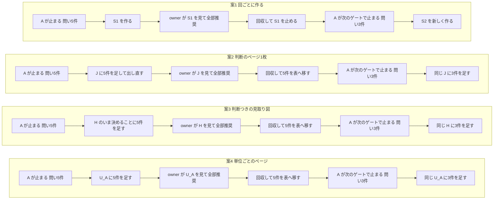
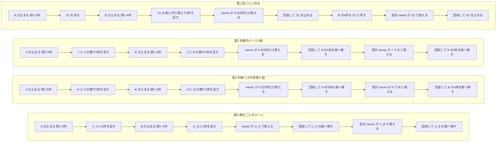
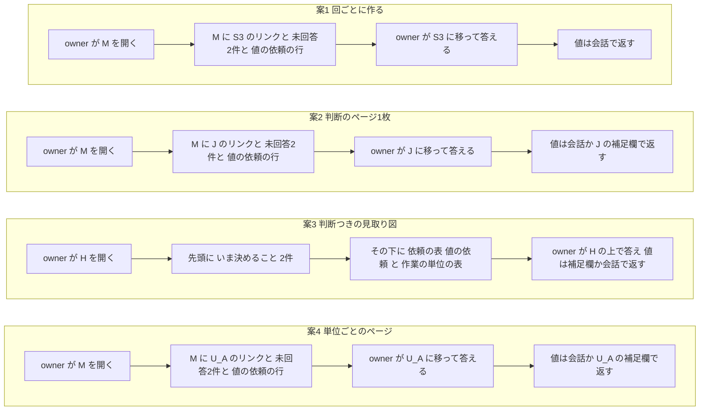
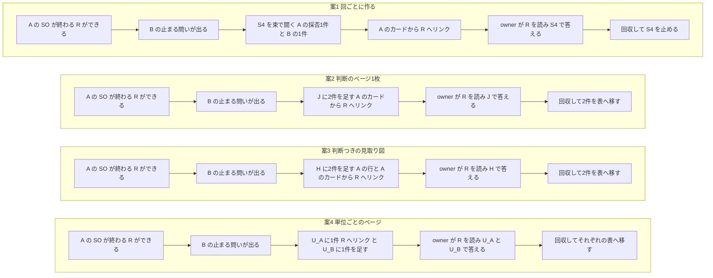
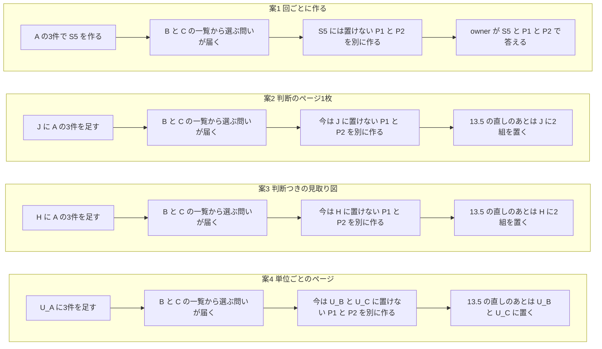

# #466 判断のページ・SO のまとめ・見取り図を、オーケストレーションの流れで作り・更新し・止める（判定の材料）

## 0. この文書の位置と読み方

- この文書は、owner が #466 の8つの論点を判定するための材料である。判定はまだ置いていない。owner の判定は、このあと decision に記録する。コードと配布物（スキル・ルール・設定）は、この単位では変えない。
- 種別は html-one-pager の7つ（`confirm`・`approve`・`pick`・`map`・`bundle`・`review`・`board`）を指す。和名は認識合わせ・承認・一覧から選ぶ・見取り図・束・レビュー・判断ボードである。
- 言葉の使い方は次のとおりにする。
  - **判断のページ**: owner に問いへ答えてもらうページ。issue 本文の「判断シート」にあたる。どの種別にするかは論点1 で決める。
  - **SO のまとめ**: SO（セカンドオピニオン）の指摘と採否を見せるページ。
  - **見取り図**: 作業の進み具合と4層の文書（discussion・plan・episode・decision）を見せるページ。
  - **開いている**: 状態が回答待ち（`awaiting`）で、owner がまだ答えられるページ。**止める**は、それ以上は出し直さないことを指す。
  - **作業の単位**: 1つの委譲（1つの brief と1つの枝）を指す。
  - **owner 宛ての問い**: 統括が自分の権限で決めず、owner に決めてもらう問い。子が統括に出す問いのうち、統括が自分で決めるものは含めない。
  - **台帳**: ページの URL・種別・状態・データの置き場を並べた記録（論点4 で提案する）。
- 根拠の強さは各行に付けた。`[verified]` は出典を開いて確かめた主張、`[measured]` は手元の記録を数えて確かめた主張、`[unverified-summary]` は出典はあるが言い切れるかを確かめていない主張、`[speculation]` は出典の無い推測である。
- 公開の文書なので、別のリポジトリの名前と中身は書かない。数だけを書く。統括の引き継ぎ文書（作業層の `.oe/handoff.md`）を材料にしたが、そこにある業務のリポジトリの情報は写していない。

## 1. 推奨の一覧（先に読む表）

注（2026-10-24・owner の答えのあと）: owner の答えは推奨どおり21問・別の案4問（Q1・Q3・Q18・Q20）・未回答1問（Q7）だった。この表は答えの前の推奨のままにしてある。Q1 と Q3 は13節で詰め直している。

| 論点 | 推奨 | 一言の理由 |
|---|---|---|
| 1. 出来事と種別の対応 | 判断のページは回ごとに作る。1つの作業の単位の問いだけなら `approve`（認識合わせなら `confirm`）、2つ以上の単位にまたがるなら `bundle` にする。`board` はこの流れでは使わない。**開いている判断のページは、答えを集める統括ごとに同時に1枚だけ**にする。例外は一覧から行を選ぶ問いで、別の `pick` のページにする。最初に伝えたあとに足したカードには「追加」の印を付け、「全部推奨」のような一括の答えは印の無いカードにだけ当てる。承認済みの plan や brief を変える問いは、統括に任せた範囲かどうかより先に再承認の問いとして扱う。マージの依頼はカードにせず、頼んだことと済んだことの対で追う。SO のまとめは `review`、見取り図は `map` で、出来事ごとの扱いは論点1 の 1-2 の表のとおり | owner が答える場所を1つに保てる。owner の案「答えを消費したら更新しない」と合う。足したカードを owner が読まずに承認したことにしない |
| 2. 閾値 | owner 宛ての問いが2件たまったら開く（owner の案）。ただし、答えが無いと子か統括が先へ進めない問いは1件でもすぐ開く。開いているページがあれば、閾値に関係なくそこに足す | 待つと子が止まったままになる。ゲートの停止はもともと3件以上の問いを持つ |
| 3. 並列の子の問いの経路 | 束を作るのは統括だけにする。子は今の問いのファイル（`.oe/question-<issue>-<n>.md`）に加えて、カードのデータ（送り元つき）を書き、統括が選り分けて開いているページに足す | 答える場所が子の数だけ増えない。統括がカードを書き起こす手間が減る |
| 4. URL の置き場と引き継ぎ | 作業層に台帳を1つ置く。台帳は状態の表でなく、出来事を足していく記録（問いが出た・ページの版を出した・版を伝えた・答えた・回収した・子へ送った・子が受け取った）にし、いまの状態はそこから読む。引き継ぎ文書は台帳を指す。owner には見取り図から開いている判断のページへのリンクを出す。答えを回収したページは止め、未回答のカードは次のページへ同じ key で写す | 交代と3日で消える一時の場所をまたいでも、同じ URL へ出し直せる。どの版を伝えたか・子が受け取ったかを後から言える |
| 5. 答えの回収 | 手順に入れる。owner の発話がどのページのどのカードへの答えかを先に決め、回収前のページなら保存先を読み、ページの答えと会話の原文を answers に写し、回答済みで出し直し、答えを使う先（子・認識合わせの確定版・ゲート3 の承認の記録）へ渡し、子なら受け取りを確かめ、各段のあとに台帳に足す。会話の答えは、カードと答えが一通りに決まるものだけ受け付け、原文を補足に残す | 記録では、答えた場所が分かる14枚のうち12枚で会話が答えの経路に入っている。保存先を読まない運用は、ページの答えを正とする決まりと食い違う。`oe-send` の exit 0 は配送の成功を意味しない |
| 6. 見取り図 | リポジトリの統括ごとに1枚にまとめ、交代しても同じ URL を使う。行は作業の単位、列に段・子の状態・4層の文書・SO のまとめ・PR を置く。「owner の手番」の表（開いている判断のページ・マージの依頼・知らせ）も同じページに置く | owner が開く URL が1つで済む。統括が観測できる出来事だけで更新できる |
| 7. SO のまとめの境界 | この issue は「いつ作るか・誰が出すか・URL をどこへ置くか・いつ止めるか」だけを持ち、中身と作り方は #329 が持つ。#329 が入るまでは、SO を回したセッションが `review` の種別で作る | 中身の決まりを二重に持たない |
| 8. 実装の形と分け方 | 規則を先に、道具をあとに、段を分けて両方作る。いつ作るかの規則は、ページを作るときにだけ読まれる html-one-pager には置けないので、出来事の名前で発火する新しいスキルに置く。単位は U1 判断のページと手番の表・U2 見取り図の残り・U3 SO のまとめ（#329 の側）・U4 道具の4つに分け、U1 → U2 → U4 の順に行う | ページを作るスキルは「いま作れ」を言えない。いまの道具だけでは完結しない（公開と回収はセッションの道具で行っている） |

推奨をまとめると、「owner が答える場所は、開いている判断のページ1枚と、その URL を伝える会話の1行だけにする。ページは統括だけが開き、問いが2件たまるか、止まる問いが1件出たら開き、答えを回収したら止める（一覧から行を選ぶ問いだけは別のページになる）。見取り図は統括ごとの1枚で、どこで答えるかの入口も兼ねる」になる。

## 2. いまの運用の実物

### 2.1 判定ページの作られ方と答えられ方（2026-10-17〜10-23）

統括の引き継ぎ文書の記録から、owner に判定を求めたページを数えた。10-19 までのページは html-one-pager より前の手作りで、種別の列は今の種別に当てはめたものである。[measured]（`.oe/handoff.md` の 18代目と19代目の経過の行。記録は要約なので、件数は下限である）

| 日付 | 作業 | 今の種別に当てると | カードの数 | owner が答えた場所 |
|---|---|---|---|---|
| 10-17 | 次に着手する候補の選択 | `pick` | 10 | ページ（合図は会話の「選んだ」） |
| 10-18 | #391 ゲート3 | `approve` | 8 | 会話（統括は保存先を読んでいない） |
| 10-18 | #391 の再承認と #450 ゲート3 を1枚に | `bundle` | 9 | 会話（保存先は空）。owner の指摘で同じ URL に2回出し直した |
| 10-18 | #401 ゲート3 | `approve` | 6 | 会話 |
| 10-18 | #385 の判定 | `approve` | 8 | 会話（統括は保存先を読んでいない） |
| 10-19 | #428 ゲート3 | `approve` | 5 | 会話 |
| 10-20 | #407 の判定 | `approve` | 16 | 会話（保存先は空） |
| 10-20 | 認識合わせ4件 | `confirm` | 4 | ページと会話（保存先に4件と、会話の「全部確定」と直しの指摘） |
| 10-20 | #469 ゲート3 | `approve` | 5 | 会話 |
| 10-20 | #456 ゲート3 | `approve` | 6 | 会話（追加の要件も会話で） |
| 10-21 | #467 の材料の選択 | `pick` | 1（候補は表に40件） | ページと会話 |
| 10-21 | #467 ゲート3 | `approve` | 6 | ページと会話（保存先に6件と補足） |
| 10-23 | #478・#477 の認識合わせ | `confirm` | 2 | 記録に無い |
| 10-23 | #478 ゲート3 | `approve` | 5 | 子のペインに直接書いた（統括が子の会話記録で確かめた） |
| 10-23 | #478 の承認後の変更の小さなゲート | `approve` | 3 | 会話（「サンプルで作ってくれた方が早い」） |

ここから言えることは次の5つである。

- 15枚のうち、会話だけで答えたのは9枚、ページと会話の両方が3枚、ページだけが1枚、子のペインに直接が1枚、記録に無いのが1枚だった。答えた場所が分かる14枚のうち12枚で、会話が答えの経路に入っている。[measured]
- ページだけで答えた回も、統括が保存先を読みに行く合図は会話の一言（「選んだ」）だった。[measured] ページに保存しても統括には届かない。html-one-pager の回収は統括が保存先を読みに行く形で、保存先から統括へ知らせる手順は書かれていない。[verified]（`canonical/skills/html-one-pager/SKILL.md` の「答えを受け取る」「回答済みにして出し直す」節）
- owner の答えの多くは一括の答えで、15枚のうち12枚で「全部推奨どおりで」「全部確定」のような一言を会話か子のペインで出した（一部を直す「基本推奨でよくて、issue にするのは一つ」を含む）。[measured]
- ゲートで子が止まったときのページは、カードが3〜16枚あった。カードが1枚か2枚のページは無い。[measured]
- 2つの作業の単位の問いを1枚にしたのは、#391 と #450 の1回だけである。同じ日に並列で止まった #469 と #456 は、別々のページになった。[measured]

### 2.2 ページの外で、会話に流れたもの（同じ期間）

ページに載らずに会話で owner に向けたものを、同じ記録から数えた。[measured]（同じ出典・下限）

| 種類 | 件数 | 例 |
|---|---|---|
| 単独の問い | 5件（4回の発話） | issue を閉じるか開けておくか（2件）、別のツールを対象に含めるか、手順を標準にするかと起票するか（2件を1回で） |
| マージの依頼 | 11件（PR 11本） | 照合が済んだ PR のマージ |
| 表示の確かめの依頼 | 2件 | 見本のページの表示の調整、サンプル7つの確認 |
| 知らせ（答えは求めていない） | 4件 | 承認のあとの補正を1行で見せる |

この表が数えているのは種類と件数で、混ざったり取りこぼしたりした場所と回数ではない。そのうえで、issue 本文の「問いがいくつか重なって流れていて、答えたものと答えていないものが混ざる」は、ゲートのページより、この表の種類で起きている、と見立てる [speculation]。ゲートのページはすでに毎回作られている（10-20 以降、統括は判定を求めるたびに html-one-pager でページを作っている。確定版の「issue に書いていないが要ること」の1行目）が、ページの外の問い・依頼・知らせには決まった置き場が無いからである。

### 2.3 子の問いの受け渡し

- 委譲された子は、判断の要る問いを `.oe/question-<issue>-<n>.md` に「前提・選択肢・推奨と理由」で書き、パスを `oe-send` で統括へ1行送って待つ。作業層には、この形の問いが6件ある（2026-09-11〜10-19・#336・#403・#428・#442 の2件・#450）。[measured]
- この決まりは canonical のどのスキルにも本文としては無い。brief の可変節（「問いは `.oe/question-<issue>-<n>.md` に書き」）と、`issue-intake` の hub の補足の節にだけある。[verified]（`grep -rn 'question-<' canonical/` が `canonical/skills/issue-intake/SKILL.md:344` の1件だけを返す）
- 統括は問いを読んで、自分で決めるか owner に回すかを選り分けている。子の範囲の問い（同じスクリプトの同じ型の直しなど）は統括が決めてよい、という運用がある。[unverified-summary]（`.oe/handoff.md` の「確立した運用」）

### 2.4 ページの URL とデータの置き場

- ページの URL は、統括が引き継ぎ文書の「渡らないもの」の節と経過の行に手で書いている。決まった置き場は無い。[measured]
- ページのデータ（JSON）は、統括のセッションの一時の場所（scratchpad）に書かれ、あとからリポジトリの `tmp/cockpit19-scratch/` などに写されている。scratchpad はおよそ3日で macOS に消される。[unverified-summary]（`.oe/handoff.md` の「渡らないもの」と、統括の memory）
- 同じ URL へ出し直すと、保存先（artifact の db）の答えは残る。[verified]（html-one-pager の「公開する」節）
- 別の会話から同じ artifact に出し直すときは、先にその artifact を読む必要がある。読まずに出し直すと拒まれ、いまの版が返される。[verified]（Artifact の道具の説明の「To update an artifact from an earlier conversation」）。統括が交代すると、後継はこの手順を踏む。

### 2.5 html-one-pager が決めていること

- 答えの場所はページの1つだけで、会話で答えを1件ずつ受け取る形は使わない。例外は「全部推奨どおり」の一言で、このときもページに保存した答えがあれば、その項目はページの答えを正とする。[verified]（`canonical/skills/html-one-pager/SKILL.md` の「答えを受け取る」節）
- 回収したあとはページに埋め込んだ `answers` を正とし、回答済みのページは保存先を読まない。[verified]（同「回答済みにして出し直す」節、#428 の decision の決定4）
- ページの状態は `awaiting`（回答待ち）・`answered`（回答済み）・`live`（随時更新）の3つだけである。答える部品の無いページ（見取り図・レビュー）は `awaiting` にできない。`answered` は空の `answers` でも通るので止めることはできるが、札は「回答済み」と出る。**更新を止めた見取り図やレビューを表す専用の状態は無い。** [verified]（`canonical/skills/html-one-pager/build.py:57` の `STATUSES`、同 439〜443 行の E-P2、`glossary.md:26-28`。`examples/table.json` と `examples/review.json` を `status: answered`・`answers: {}` に変えると `check` が exit 0 で通り、`build` の出力の札が「回答済み」になることを手元で確かめた）
- `bundle` のカードの札は自由な文字列で、識別子（`Q2` のようなページの中のアンカー）を定義しない。`approve` と `board` だけが `Q<数字>` を定義する。[verified]（SKILL.md の「札と番号」節）
- いまの手順では、ページを公開するのは Artifact の道具で、保存先を読むのは `ArtifactData` の道具である。どちらもセッションの中の道具である。`build.py` は HTML を作るところまでで、公開も回収もしない。[verified]（SKILL.md の「公開と回収」節。engine の `bin/` に artifact を扱う verb は無い）セッションの外から公開や読み取りに接続できるかは、確かめていない（11節）。

### 2.6 2026-10-23 の owner の指摘（#478 の H8）

#478 で、表示の直しの案を判定ページに文で並べたところ、owner は「このパターンなら、修正前のサンプルで作っちゃってくれた方が早い。表示見た方が戻し少ない」と答えた。見た目に関わる案は、推奨をサンプルに当てて同じ URL に出し直し、表示で見せるほうが往復が少ない。[unverified-summary]（`.oe/handoff.md` の 10-23 の行、統括の memory）

## 3. 比べる基準

brief の3つを使う。

- **K1 答えやすさ**: owner が答える場所を探さずに済むか。答え漏れ（答えたつもりの問いが回収されない・答えていない問いに気づかない）が減るか。
- **K2 統括の手間**: 統括の操作の数と、統括のセッションの文脈（context）の消費。
- **K3 壊れ方**: ページが古くなる（中身が実際と食い違う）・答えを取りこぼす・二重に聞く、が起きるか。

各論点の表では、良い・中・悪いで書く。比べた相手は同じ論点のほかの選択肢である。

## 4. 前提として固定すること（owner がどの面で見て答えるか）

knowledge item `01M19CPRGAY3GJMM1DQPFKPFW0`（「表示する」依頼では、どの面かを実物で特定する）に従い、論点に入る前に面を決める。

- **owner が戻ってくる場所は、統括の会話（ターミナル）である。** ページを開くのも、答えたと伝えるのも、ここを起点にしている（2.1 節）。
- **ページは読む場所で、答える場所にもなる。** ページだけで答えた回は1枚しかないが、ページと会話の両方が3枚あり、ページを読んでから会話で「全部推奨」と言う形が多い（2.1 節）。
- **子のペインは、owner が答える場所として想定しない。** ただし実際に1回あった（#478）。起きたら統括が拾う（論点5）。
- これらの比率は、引き継ぎ文書の要約に残った回の比率である。これから最もよい入力の面を決めるものではない。入力の面そのものをターミナルへ移す代わりの案は、7節の代替B で扱う。

したがって、この文書の推奨は「会話には URL と件数の1行だけを置き、問いの中身と選択肢はページに置く。答えはページでも会話でもよいが、統括が回収するときに1か所（`answers`）にまとめる」を前提にする。見取り図は、owner が「いま何を答えればよいか」を探す入口になる。

## 5. 論点ごとの選択肢と推奨

### 論点1 出来事と種別の対応表

注（2026-10-24・owner の答えのあと）: Q1（種別）と Q3（一覧から選ぶ問いの例外）は別の案になった。第一目的を「並列の作業で迷わないこと」とし、答え方の形でページを分けない前提で、13節で比べ直している。「手番」の語は使わない（Q6）。この論点の表と順序のうち Q2・Q4・Q5・Q6 は推奨どおりで決まった。

#### 1-1 「判断シート」はどの種別か

| 案 | 中身 | K1 | K2 | K3 |
|---|---|---|---|---|
| 1A（推奨） | 回ごとに作る。1つの作業の単位の問いだけなら `approve`（認識合わせなら `confirm`）、2つ以上の単位にまたがるか、種別の違う問いが混ざるなら `bundle`。回収したら `answered` で止める | 中: 回ごとに URL が変わるが、開いているのは1枚だけ（1-3）で、会話と見取り図が URL を伝える。開いているあいだにカードが足されるので、一括の答えの範囲を決める必要がある（1-3） | 中: 作り方は今と同じだが、追加の印・`bundle` への作り替え・未回答の写し・台帳と見取り図の更新が加わる | 中: 回収した答え（`answers`）は変わらないが、前に開いていた画面からの書き込みは止められない。未回答の写し忘れ・台帳と見取り図の更新忘れが起きうる |
| 1B | 判断ボード（`board`）1枚を更新し続ける。決まったカードは表へ移す | 良い: URL が1つ | 中: 出し直すたびに決まったことの表が伸びる。カードを表へ移す手間は、1A の未回答の写しと同じくらいかかる | 中: 移し忘れ・番号の使い直しを `build.py` は見ない（#478 の decision の決定4）。1A の写し忘れと同じ種類の壊れ方で、どちらが起きやすいかは測っていない |
| 1C | いつも `bundle` にする（単位が1つでも group 1つ） | 中: 種別が変わらない | 良い | 中: `bundle` は `Q<数字>` を定義しないので、owner が会話で「Q2 は別案」と言いにくい。ゲート3 の全体の承認のカードを最後に置く決まりも、`build.py` は見ない |

推奨は 1A である。owner の案は「答えを消費したら、そのシートは更新しない」で、更新し続ける 1B と合わない。壊れ方（K3）だけで比べると、1A の未回答の写し忘れと 1B の移し忘れは同じ種類で、大きな差は無い。1B を採らない理由は、owner の案と合わないことにある。1B の「URL が1つ」の利点は、見取り図を入口にすることで取り込む（論点6）。owner は音声で問いの番号を言うことがある（引き継ぎ文書の「聞き取りの癖」）ので、番号を定義できる `approve` を、単位が1つのときの既定にする。

`bundle` にするときは、カードの札に `Q<数字>` を自由な文字列として書き、ページの中で番号を使い直さない。`bundle` ではアンカーにならないが、会話で番号を言える。ゲート3 の承認を `bundle` に入れるときは、その単位の group の最後に全体の承認のカードを置く（`build.py` は見ないので、統括の手順で守る）。

#### 1-2 出来事ごとの扱い

| 出来事 | 判断のページ | SO のまとめ | 見取り図 |
|---|---|---|---|
| E1 owner 宛ての問いが出る（子の問いのファイル・子のゲートの停止・統括自身の問い） | 1-3 の順に当てる。開いていれば足して同じ URL に出し直し、件数を会話の1行で伝える。最初に伝えたあとに足したカードには「追加」の印を付ける。無ければ論点2 の閾値で開く | — | 「owner の手番」の表に行を足す（保留中の問いも出す） |
| E2 owner が答える（ページ・会話・子のペイン） | 論点5 の手順で回収し、`answered` で出し直して止める。一括の答えは「追加」の印の無いカードにだけ当てる。追加のカードと未回答のカードは次のページへ写す（論点4） | — | 手番の行を「答えた」にし、次のページがあれば差し替える |
| E3 SO が終わる（設計SO・実装SO・Copilot の1ラウンド） | 採否を owner に聞くものがあれば E1 として扱う | SO を回したセッションが作る。採否を決めたあと1回出し直して止める（論点7） | その単位の行に URL を足す |
| E4 作業の単位の段が移る（委譲・ゲート3 の承認・PR の作成・マージ・close） | — | — | その単位の行を直す。close で「終わった」の表へ移す |
| E5 子が止まる（終端の停止・`NEEDS_CONTEXT`・`BLOCKED`・予期しない停止） | 問いを伴えば E1 | — | 止まっている理由を行に書く |
| E6 統括が交代する | 開いているページは引き継ぐ。後継は台帳から URL を取り、artifact を読んでから出し直す。回収の途中で交代したら、台帳の最後の出来事から続ける（論点5） | 同じ | 同じ。後継が最初に出し直すとき、送り元（tmux の位置）が自分に変わる |
| E7 問いが要らなくなる（子の作業が取り消された・統括が自分で決めた） | カードは外さず、題に「取り下げた・答えなくてよい」と書いて出し直す。回収のときは `answers` に `choice: null` と補足「取り下げた」を書く（保存先の答えは key で残るので、外すと記録が切れる）。開いたカードがすべて取り下げになったら、その場で `answered` で止める（カードが0枚のページは `build.py` の E-S1 が止めるので作れない） | — | 手番の行を外す |
| E8 owner に表示を見て判断してもらう（「この表示で進めてよいか」） | 推奨をサンプルに当てて同じ URL に出し直し、判断のページには「この表示でよいか」のカード1枚とサンプルへのリンクを置く | — | — |
| E9 owner に操作を頼む（マージ・画面を開く・値を貼る） | カードにしない。値は、関係するカードの補足欄か会話で受け取る（#478 の決定のまま） | — | 手番の表に「頼んだ」の行を置き、owner の操作を統括が確かめたら（マージなら origin で、値なら受け取ったら）「済んだ」にする。ゲート5 の owner のマージを、頼んだことと済んだことの対で追う |

E8 と E9 の境目は、owner に判断を求めるかどうかである。サンプルを開いて見てもらうだけなら E9、表示を見て進めてよいかを決めてもらうなら E8 にする。

操作の依頼と知らせ（2.2 節）は、答えを選ぶ問いではないので、判断のページのカードにしない。カードにしないことと、追わないことは別である。マージはゲート5 の owner の操作なので、頼んだことと済んだことを手番の表の行の状態で追う（E9）。知らせは答えを求めないので、出したことだけを残す。選んでもらう必要が出たら、そのときに E1 として問いにする。

#### 1-3 当てる順序と、どちらにも読める出来事

knowledge item `01M55M68F2Q128X7AZ1JN2X7WC`（分類を新設したら、判定の順序とどちらにも読める形の扱いを書く）に従い、owner に向くものが1件出たら、次の順に当てる。軽い扱い（統括が決める・カードにしない）に落としたくない形を先に除く順に並べた。

1. **承認済みの対象を変えるか。** ゲート3 で承認した plan・委譲時の書面・ゲート表を変える問いで、委譲固定節の「承認のあとに plan が変わるとき」の「変更」の級（step を削る・要件を弱める・ゲートを飛ばす・終端を書き換える・新しい作業義務や設計判断や対応範囲を足す）に当たるなら、統括に任せた範囲かどうかに関係なく、owner の再承認の問いとしてカードにする。回収のあとは、承認の記録に entry を足してから子へ送る（論点5）。
2. **統括が自分で決められるか。** owner が前もって統括に任せた範囲（例: 子の範囲の問いのうち、同じスクリプトの同じ型の直しは統括が決めてよい・owner 2026-10-13）の中なら統括が決め、ページを作らない。決めたことは、次の報告か見取り図で知らせる。任せた範囲は、いまは引き継ぎ文書の「確立した運用」に散らばっている（7節の代替D）。
3. **表示を見て判断してもらう問いか。** そうなら E8 の形にする（サンプルを先に直す）。サンプルを開いてもらうだけの依頼は、ここではなく 4 に当たる。
4. **答えを選ぶ問いか。** 操作の依頼（マージ・画面を開く・値を貼る）と知らせなら、見取り図の手番の表に行を出す。依頼は「済んだ」を確かめるまで追う（E9）。
5. **判断のページに入る形か。** 一覧から行を選ぶ問い（`select` を使う問い）は、`approve` にも `bundle` にも置けない（`build.py` の `pick_rows` が E-K2 で止める）。別の `pick` のページを開き、会話の1行と手番の表に2枚とも出す。これが「1枚だけ」の唯一の例外である。
6. **開いている判断のページがあるか。** あれば、閾値に関係なくそこに足す。owner に最初に伝えたあとに足すカードには「追加」の印を付ける。
7. **答えが無いと子か統括が先へ進めない問いか。** そうなら1件でもページを開く。
8. 残りは保留にし、2件目が来るか、ほかの理由でページが開くときに一緒に載せる。

順序の1 は、ゲート2 の設計SO の指摘で足した。最初の案は「統括が決められるか」から始めていたので、承認のあとに「同じ型の直しを別の対象にも当てる」のような対応範囲を足す問いが、任せた範囲の例に似ているというだけで統括の判断に落ちえた。knowledge item `01M55M68F2Q128X7AZ1JN2X7WC` が予測する「足す方向が軽い側を素通りする」形である。順序の3 と 5 も、ゲート2 で境目の具体の形（「修正版の表示で進めてよいか」・開いている `approve` に届く「候補40件から上位2件を選ぶ」）を当てられて足した。

どちらにも読める出来事は次のように扱う。

- **問いが1件だけで、子が止まる**: 7 に当たり、1件でページを開く（論点2）。
- **SO の結果と問いが同時に出る**: SO のまとめは読むだけのページにし、採否を owner に聞くものは判断のページのカードにして、カードから SO のまとめへリンクする。答える場所を2つにしない。
- **ゲートの停止と、別の子の問いが同時に出る**: 2つの単位にまたがるので `bundle` にする。
- **開いている `approve` のページに、別の単位の問いが来る**: 同じ URL のまま `bundle` に作り替える。カードの key と札の番号は変えない（保存先の答えは key で残るので、key を変えると答えが外れる）。
- **開いている `approve` のページに、一覧から行を選ぶ問いが来る**: 5 に当たり、別の `pick` のページにする。
- **「修正版の表示で進めてよいか」**: 表示を見て進めてよいかを決めてもらうので、3 に当たる（E8）。
- **owner がページを読んでいるあいだに、統括がカードを足す**: 一括の答えの範囲を、次の4案で比べた。

| 案 | 中身 | K1 | K3 |
|---|---|---|---|
| 版を伝える（ゲート1 のあとの初稿） | 足したら版を会話で伝え、一括の答えは最後に伝えた版のカードに当てる | 良い | 悪い: 伝えた時刻は読んだ証拠にならない。版1 を読んでいるあいだに版2 を伝え、その直後に「全部推奨」と言われると、読んでいない追加分に当たる |
| 追加の印（推奨） | owner に最初に伝えたあとに足したカードには「追加」の印を付ける。一括の答えは印の無いカードにだけ当て、追加のカードはページで選ぶか名指しで答えてもらう | 中: 追加のカードは一括で済まない | 良い: 時刻を推し量らずに、一括の答えの範囲がページの上で決まる |
| 足さない | 伝えたあとは足さず、次のページまで待たせる | 悪い: 止まる問いが来たら2枚目を開くことになり、1枚の決まりが崩れる | 中 |
| 版を言ってもらう | owner に「版2 全部推奨」の形で答えてもらう | 悪い: 毎回言う手間がかかる | 良い |

推奨は「追加の印」である。印の出し方（題の頭に書くか、カードに項目を足すか）は U1 で決める。追加のカードが残ったまま回収したら、そのカードは未回答として次のページへ写す。

### 論点2 「問いが2つたまったら」の閾値と、1つでも子が進めないとき

注（2026-10-24・owner の答えのあと）: Q8 は推奨どおりで決まった。13節の案3 を採ると、閾値は「ページを開く」条件でなく「いま決めることにカードを足して案内を送る」条件に変わる（13.4）。

| 案 | 中身 | K1 | K2 | K3 |
|---|---|---|---|---|
| 2A | 1件でもすぐページを開く | 良い: 会話で問いが流れない | 悪い: 単独の問い（2.2 節で5件）のたびにページを作る | 良い |
| 2B（推奨） | 2件たまったら開く。止まる問いは1件でもすぐ開く。開いているページがあれば足す | 中: 保留の問いは見取り図で気づけるが、そこでは答えられない | 中 | 中: 保留の問いが長く待ちうる（下の順序の決まりと見取り図の表示で受ける） |
| 2C | 時間で区切る（例: 30分ごとにまとめて開く） | 中 | 中 | 悪い: 止まる問いを最長30分待たせる。統括が時刻を見張る仕組みが要る |
| 2D | 2件たまるまで待つ。止まる問いも例外にしない | 中 | 良い | 悪い: 子が止まったまま2件目を待つ。止まった子は外から作業中と見分けにくい（#390 では、止まったことに気づかれないまま11時間たった [unverified-summary]・統括の memory） |

推奨は 2B である。2件の閾値は owner の案をそのまま採り、止まる問いだけを例外にする。例外が無いと、問いが1件しか出ない日に子が止まり続ける。2A は答えやすさでは良いが、記録の単独の問い5件はどれも止まる問いではなく（閉じるかどうか・対象に含めるかどうか・手順を標準にするか）、急がない問いのためにページを作る手間が増える [speculation]（5件の性質は記録の文面から読んだ）。

保留にした問いは、次にページが開くときに必ず載せる。これは順序の決まりで、時間の上限ではない。作業の単位はいずれゲートで止まり、ゲートの停止は止まる問いなのでページが開くが、次のゲートまでの時間は決まっていない。急がない問いが長く待つことは許し、待っていることを見えるようにする。保留中であることは、見取り図の手番の表に「保留」として出す（答える場所ではない）。

### 論点3 並列の子の問いを束に集める経路と、束を作る主体

注（2026-10-24・owner の答えのあと）: Q9・Q10 は推奨どおりで決まった。Q10 には「子の問いのデータに、統括の判断も足して載せる」という補足が付いた。

| 案 | 中身 | K1 | K2 | K3 |
|---|---|---|---|---|
| 3A | 子は今の形（Markdown）で書き、統括がカードに書き起こす | 良い | 悪い: 統括が問いごとに読み直して書く | 中: 書き起こしで意味がずれうる |
| 3B（推奨） | 子はカードのデータ（JSON・`build.py source --git` の送り元つき・key は単位ごとの前置き付き）を問いの正本として書き、Markdown は書かないか、カードのデータから作る。統括が選り分けて、開いているページに足す | 良い | 中: 統括は選り分けと確かめが主になるが、古いカード・推奨の根拠の誤りを確かめる手間は残る。子の手間は増える | 中: Markdown とカードを別々に書くと食い違うので、正本を1つにする。key の重なりは `build.py` の E-C1 が止める |
| 3C | 道具が問いのファイルを集め、束のデータを作る | 良い | 良い | 中: 自由な文を読んで選り分ける（統括が決めるか owner に回すか）部分は、今の道具には無い。子が問いの種類と、統括に任された範囲かを明示すれば、機械で振り分けられる部分はある |
| 3D | 子が自分でページを出し、統括は URL を集める | 悪い: 答える場所が子の数だけ増える | 良い | 悪い: 二重に聞く・回収が子ごとに分かれる |

推奨は 3B で、3C は論点8 の道具の単位で足す。**束を作り、owner が答えるページを出すのは統括だけにする。** 子は owner の面を直接持たない。統括は 2.3 節のとおり問いを選り分けている。自由な文を読んで決める部分は、今の道具には無い。html-one-pager の「判断待ちの束」の節は、判断を出す側のセッションが送り元を出し、カードと一緒に束を作る側へ渡すと書いている [verified]（SKILL.md の「判断待ちの束」節）。ページを出すのを統括だけにすること、カードのデータを問いの正本にすること、Markdown を書かないかカードのデータから作ることは、この文書の提案で、その節からは導けない。

ゲートの停止（plan や discussion を書いて止まる）でも、子は plan の問いをカードのデータで添えてよい。統括は plan を照合したうえでカードを直して載せる。照合は統括の仕事のままである。

### 論点4 URL を残す場所・同じ URL への出し直し・未回答の引き継ぎ

注（2026-10-24・owner の答えのあと）: Q11（台帳）は推奨どおりで、専用のものを作る。ログをもっと厳密に分ける話は別に扱う。Q13（未回答の引き継ぎ）は推奨どおりだが、Q1 の決め方で要るかが変わる（13.6）。

| 案 | 中身 | K1 | K2 | K3 |
|---|---|---|---|---|
| 4A | 今のまま、引き継ぎ文書に手で書く | 中 | 中 | 悪い: 書き忘れ。散文の中にあり、機械で読めない |
| 4B | 作業層（版管理の外で、3日で消えない場所）に台帳を1つ置く。1行1ページで、URL・種別・状態（開いている・止めた）・作業の単位・データの置き場・未回答の key を持つ。引き継ぎ文書は台帳を指す | 中 | 中: 出来事のたびに行を書き換える | 中: 交代しても同じ URL へ出し直せるが、どの版を伝えたか・子が受け取ったかは残らない |
| 4B'（推奨・ゲート1 の代替A を取り込んだもの） | 4B の台帳を、出来事を足していく記録にする。1行1出来事で、問いが出た・ページの版を出した・版を伝えた・答えた・回収した・子へ送った・子が受け取った、を問いの key・ページの URL・時刻つきで書く。いまの状態（開いているページ・未回答・未配送）はそこから読む | 中 | 中: 書く行は増え、いまの状態を読むには記録をたどる手間がかかる（U4 の道具ができるまでは手で読む） | 中: 送ったが受け取られていないものや、回収の途中で止まった位置を後から言える。ただし記録そのものの書き漏れは防げない |
| 4C | issue のコメントに URL を書く | 中 | 中 | 中: 2つの単位にまたがる束の置き場が決まらない。公開の場所に private のページの URL が並ぶ |
| 4D | 見取り図のページの中だけに書く | 良い | 良い | 悪い: 見取り図の URL そのものの置き場が別に要る。統括が機械で読めない |

推奨は 4B' で、owner に向けては 4D を足す（見取り図から開いている判断のページへリンクする）。台帳は統括が読む正本、見取り図は owner が見る入口である。台帳の形は、論点8 の道具（U4）が読める決まった形にする。ページそのものを台帳から作る形（ゲート1 の代替A の全部）にするかは、U4 で決める。

同じ URL へ出し直す手順は次のとおりにする。

- 同じ会話の中では、同じデータのファイルから作り直し、同じファイルのパスで公開する（Artifact の道具の決まり）。
- 交代した後継は、台帳の URL を Artifact の道具で読んでから、その URL へ公開する。データは scratchpad に置かない。
- データが失われたら、作り直そうとしない。答える部品のあるページに埋め込まれたデータは、保存のコードが使うカードの key と選択肢だけで、要点や本文は入っていない [verified]（`build.py` の `page_data` と `self.cards.append`）。保存先を読んで答えを回収し、同じ URL に「このページは閉じた。続きは新しいページで答える」とだけ書いた短いページを出して止め、未回答のカードを新しいページに作り直す。owner には会話の1行で URL が変わったことを伝える。
- カードの key は出し直しで変えない。保存先の答えは key で残るので、key を変えると答えが外れる。

**止めたページに未回答のカードが残ったとき**の扱いは、次の3つを比べた。

| 案 | 中身 | K1 | K3 |
|---|---|---|---|
| 写す（推奨） | 止めたページは `answered` にし、未回答のカードは「未回答」と出る。同じ key のカードを次のページへ写し、カードに「前のページから引き継いだ」と書く。会話の1行で件数を知らせる | 良い: 答える場所は新しいページ1つ | 中: 回収した答え（`answers`）は変わらない。ただし前に開いていた画面からは書けてしまい（html-one-pager の「回答済みにして出し直す」節の4）、owner がその画面で答えたつもりになる事故は残る。会話の1行で「前のページは閉じた。新しい URL で答える」と伝えて受ける |
| 開いたままにする | 答えたカードだけ回収し、ページは開いたままにする | 中 | 悪い: 回収したカードも押せるので、回収のあとに答えが変わる。#428 の決定4 と食い違う |
| 会話に戻す | 未回答のものは会話で聞き直す | 悪い | 悪い: 会話に問いが流れる |

推奨は「写す」である。新しいページは、写したカードに止まる問いがあればすぐ開き、無ければ論点2 の保留と同じに扱う。

### 論点5 答えの回収を手順に入れるか・会話の答え・判断ボードの申し送り

注（2026-10-24・owner の答えのあと）: Q14・Q15・Q16・Q17 は推奨どおりで決まった（回収のたびに保存先を読む・意図が汲み取れないときは聞く）。Q18（判断ボードの申し送り）は Q1 が決まってから決める（13.6）。

| 案 | 中身 | K1 | K2 | K3 |
|---|---|---|---|---|
| 5A | 手順に入れない（今のまま統括の判断） | 中 | 良い | 悪い: 「全部推奨」と言われたときに保存先を読まない運用（引き継ぎ文書の「確立した運用」）が、ページの答えを正とする html-one-pager の決まりと食い違ったまま残る |
| 5B（推奨） | 手順に入れる（下の6段） | 良い | 悪い: 1回の回収で、保存先の読み・データの編集・検証・作り直し・公開・公開後の読み・台帳・見取り図・子への送信・受け取りの確かめの10の操作があり、未回答があれば写しが足される。台帳と受け取りの確かめのほかは、今も統括が行っている | 中: 手順が長いので段を飛ばしうる。送ったが受け取られていないものは台帳で拾う |
| 5C | 道具が保存先を見張り、答えが入ったら統括に知らせる | 良い | 良い | — いまの経路では作っていない。いまの手順で保存先を読むのはセッションの中の `ArtifactData` で、engine の `bin/` に該当する verb は無い [verified]。セッションの外から読む手段に接続できるかは確かめていない |

5B の手順は次の6段である。

1. **対象を決める**: owner が何か言ったら、まずそれがどのページのどのカードへの答えかを決める。答えでなく質問（「Q3 の意味は」）なら、答えて回収はしない。すでに回収して止めたページのカードへの発話は、保存先を読み直さず（#428 の決定4）、そのカードの答えの訂正として扱う。訂正は台帳に足し、すでに子へ送っていれば訂正として送り直す。
2. **読む**: 回収前の開いているページなら、合図の中身（「全部推奨」でも）に関係なく保存先を読む。
3. **写す**: カードごとに `answers` に写す。ページに保存した答えと、owner が会話でカードを名指しした答えが食い違うときの優先は、owner に決めてもらう（9節の16）。推奨は「会話で名指しした答えを正とし、食い違ったことを1行で返す」である。一括の答えは「追加」の印の無いカードにだけ当てる。発話からカードと答えを一通りに決められないときは、そのカードを未回答のまま残し、統括が読み取ったカードと答えを1行で返して、owner の応答を受けてから写す。会話から写した答えには、補足に owner の原文を残す。
4. **止める**: `answered` で作り直し、同じ URL に1回だけ公開する。
5. **渡す**: 答えを、その答えを使う先へ渡す。
   - 子の問いなら、子へ `oe-send` で送る。1行には issue 番号・step ID・ページの URL・カードの key を入れ、子が同じ答えを二度受け取っても見分けられるようにする。exit 0 は配送の成功を意味しない（委譲固定節の「報告の宛先」）ので、子の受け取りの返事か `oe-confirm` の受領印で、受け取ったことを確かめる。確かめられなければ、もう一度送る前に子に照会する。
   - ゲート3 の承認や、承認のあとの「変更」の再承認なら、子へ送る前に、承認の記録と baseline（初回）か entry（張り直し）を書く（`doc-flow-guardrail` の「gate 3 の baseline 記録」）。カードへの答えだけでゲート3 を済ませない。
   - 認識合わせ（`confirm`）なら、`issue-intake` の 5〜7 のとおり、合図が出たかを決め、確定版か深掘り中の版を issue に投稿する。子へ渡すのはそのコメントの URL である。
   - 統括自身の問いなら、そのまま作業に戻る。
6. **記録**: 各段のあとに台帳に出来事を足す（読んだ・写した・止めた・送った・受け取った・承認の記録を書いた・確定版を投稿した）。回収の途中で統括が止まったり交代したりしたら、後継は台帳の最後の出来事の次の段から続ける。「送った」が書かれていないときは、送ったかどうかが分からないので、送り直す前に子に照会する。未回答のカードがあれば論点4 のとおり次のページへ写す。

**owner が子のペインに直接答えたとき**（#478 の実例）は、扱いを分ける。子にとっては owner から直接受け取った答えなので、子への承認として有効である（`implementation-gate-rule` の「delivered to you」）。統括にとっては、子の会話記録で見ただけのもので、統括への承認ではない（同じ規則の「merely observed」）。統括は、子が owner から直接受け取ったことを台帳に記録し、ゲート3 の承認なら承認の記録にその経路を書く。統括が自分への承認として中継し直すことはしない。

会話の答えを受け付けるのは、記録でそれが答えの主な経路だからである（2.1 節）。受け付けないと、owner は「全部推奨」以外を言うたびにページへ戻ることになり、K1 が悪くなる。ただし受け付けるのは、カードと答えが一通りに決まるものだけである。推奨と食い違う一括の答え（例: 推奨が分かれているのに「全部 issue でいい」）は、音声の聞き取りで「推奨」が抜けた可能性があるので、外向きの操作の前に1行で確かめる [unverified-summary]（統括の memory・2026-10-24 に、この形の言い間違いが「全部推奨どおり」だった実例がある）。

**#466 のコメントにある判断ボードの申し送り2つ**は、推奨 1A ではこの流れで判断ボードを使わないので、この流れの手順には入らない。判断ボードを使う場面（ほかのリポジトリの統括の長い作業など）での扱いは次のとおりにする。

- **移し忘れ**: 回収のたびに、保存先に答えのあるカードがまだ判定カードの節に残っていないかを見て、全部「決まったこと」の表へ移す。#478 の decision の決定4 のとおり、移し忘れや番号の使い直しが実物で繰り返し起きるまで、自動で移す案は採らない。
- **値の依頼**: 値は、その値を求めるカードの補足欄か会話で受け取る（#478 の決定のまま）。回収するのは統括で、上の手順の 1〜3 と同じ回に行う。受け取った値は表の行の状態に「受け取った」と書き、値を求めた側（子か統括の作業）へ 5 の段で送る。

### 論点6 見取り図の粒度と、4層の文書の見取り図の更新の契機

注（2026-10-24・owner の答えのあと）: Q19 は推奨どおりで決まった。13節の案3 を採ると、見取り図の種別は `map` から `board` に変わる。「owner の手番の表」は「owner への依頼の表」と呼ぶ（Q6）。E9 のマージの依頼を追うこと（Q7）は未回答で、統括は「ページでは追わない」を提案している。

| 案 | 中身 | K1 | K2 | K3 |
|---|---|---|---|---|
| 6A | 作業の単位ごとに1枚 | 悪い: 並列の数だけ URL がある。索引のページを作れば探す手間は減るが、索引が1枚増える | 中: 1つの出来事で該当の1枚を出し直す。どれかは台帳で引ける | 中: 終わった単位のページを止める札が「回答済み」しか無い（2.5 節） |
| 6B（推奨） | リポジトリの統括ごとに1枚。交代しても同じ URL。行は作業の単位で、並列をまとめる | 良い: URL が1つ | 中: 1つの出来事で1枚を出し直す | 中: 統括が観測しない子の中の段の移り（D1→D2 など）は出ない |
| 6C | 6B に加えて、単位ごとの詳しいページも作る | 中 | 悪い: 1つの出来事で2枚を出し直す | 中: 手で2枚を書くと食い違う。台帳から両方を作るなら食い違わない（U4 で台帳から作る形にするなら、もう一度比べる） |

推奨は 6B である。見取り図は `map` の種別で、表を2つ置く。

- **作業の単位の表**: 番号（`ID:<数字>`）・issue・段（いまのゲート）・子の状態・4層の文書（discussion・plan・episode・decision へのリンク）・SO のまとめへのリンク・PR。
- **owner の手番の表**: 開いている判断のページ（リンクと未回答の件数）・保留中の問い・操作の依頼（マージ・画面を開く・値を貼る。頼んだ・済んだの状態つき）・知らせ。

更新の契機は、統括が観測できる出来事（1-2 の表の E1〜E7 と E9）に限る。子の中の段の移りは、子が報告しない限り統括には見えないので追わない。4層の文書の列は、子の報告（終端の停止）・ゲート3 の承認・PR の作成・マージで直す。owner の案「進み具合に応じて常に更新する」は、この契機の集まりとして実現する。

終わった単位は「終わった」の表へ移し、交代のときに後継が消す（行が際限なく伸びないため）。見取り図を止める場面は、そのリポジトリで統括を置かなくなるときだけである。

#281（オーケストレーションのフローの可視化）とは消費者が違う。#281 は「エージェント間でどんな情報が流れたか」を人と AI の両方に見せる検討で、この見取り図は「owner がいま何を答え、何を見ればよいか」を見せる。#281 が最初の問いにしている「何を可視化すると誰の何の判断が変わるか」に対しては、この見取り図が1つの答え（owner の、どこで答えるかの判断）になる。

### 論点7 SO のまとめを毎回出すこと（#329 との境界）

注（2026-10-24・owner の答えのあと）: Q20 は保留になった。SO の側が人向けの成果物まで持つ案があり、SO をオーケストレーションから独立させるかの方針が見えるまで、この issue に契機を作らない。engine の仕組みとしての可視化は必ず詰める（owner）。Q21（#329 への申し送り）は推奨どおり。

| 案 | 中身 | K1 | K2 | K3 |
|---|---|---|---|---|
| 7A（推奨） | この issue は、いつ作るか（SO が終わるたび）・誰が出すか（SO を回したセッション）・URL をどこへ置くか（子の報告と見取り図の行）・いつ止めるか（採否を決めたあと1回出し直して止める）だけを持つ。中身・作る仕組み（統括が書くか、別の段が書くか）・配線は #329 が持つ | 良い | 中 | 良い: 決まりを二重に持たない |
| 7B | この issue が SO のまとめを全部持つ | 良い | 悪い | 悪い: #329 の論点1〜3・5・6 と重なる |
| 7C | #329 が全部持ち、この issue は SO のまとめに触れない | 悪い: owner の案「毎回出す」の契機がどこにも無い | 良い | 中 |

推奨は 7A である。#329 が入るまでのあいだは、SO を回したセッションが html-one-pager の `review` の種別で作る。`review` の中身（依頼したレビューの情報・指摘・採否）は #478 の decision の決定6 ですでに決まっているので、この issue が中身を新しく決めることにはならない。

境界で確かめておくことが2つある。

- **#329 の論点4「いつ出るか」はこの issue と重なる。** この issue は「毎回」を決め、#329 は「自動で付いてくるか、統括かセッションが作るか」を決める、と分ける。#329 が自動で付く形を作れば、この issue の手順は「作られたことを確かめて URL を見取り図に置く」に縮む。
- **#329 の背景が挙げる SO は `oe-refute` と `oe-review` だが、委譲の中で実際に回している SO は `so-compare` である。** [verified]（#329 の本文の「背景」節。#407 の discussion の7節・8節と #478 の episode が `so-compare` で SO を回した記録。この単位の brief の SO モード）`so-compare` の出力も #329 の対象に入れるかは、#329 で決める必要がある。この単位では決めず、#329 への申し送りにする（10節）。

SO のまとめは読むだけのページにする。`review` の種別は判定カードを足せるが、採否を owner に聞くものは判断のページに載せる（1-3 の「SO の結果と問いが同時に出る」）。

### 論点8 実装の形と分け方

注（2026-10-24・owner の答えのあと）: Q22・Q24・Q25 は推奨どおりで決まった。Q23（規則の置き場）は推奨どおりだが、owner が起こした #537（engine を挙動を変えずに独立したパッケージにしていく）を見越して、スキルを engine の部品にするかハーネスに置くかを決める。

#### 8-1 規則か、道具か

| 案 | 中身 | K1 | K2 | K3 |
|---|---|---|---|---|
| 8A | 統括の手順の規則だけ（スキル） | 中 | 中 | 中: 守るかはモデル次第。長い会話で薄れる |
| 8B | oe の道具だけ（verb・hook・見張り） | — | — | — いまの経路では完結しない。いまの手順では、ページを公開するのも保存先を読むのもセッションの道具で、engine の verb には無い（2.5 節）。セッションの外から接続できるかは確かめていない |
| 8C（推奨） | 規則を先に作り、道具をあとに足す。道具は、台帳と問いのファイルを読んで、閾値を越えたのに開いているページが無いときに統括へ知らせる hook と、問いのカードのデータから束のデータを作る verb | 良い | 良い | 中: hook が拾うのは「閾値を越えたのに開いているページが無い」と「送ったが受け取られていない」まで（台帳が 4B' なら後者も読める）。答えたのに回収していない・ページが古い・写し忘れは、台帳に出来事が書かれない限り拾えない |

推奨は 8C である。いまの経路で道具ができることは「知らせる」と「データを作る」までで、公開と回収は統括がセッションの中で行う。

#### 8-2 規則をどこに書くか

**いつ作るかの規則は、ページを作るときにだけ読まれる場所には置けない。** html-one-pager の description は「ページを作る依頼を受けたら」読み込まれる。統括がページを作るかどうかを決める前に読まれる保証は無いので、「いま作れ」をそこに書いても届かない。knowledge item `01M486Z2ND07GQWV1GHS1SVB0J` の「受け渡し先の出口」と同じ形の穴である。

| 案 | 置き場 | 届き方 | 弱いところ |
|---|---|---|---|
| 8-2a（推奨） | ページの寿命の一般の決まり（答えを集める側ごとに開いている判断のページは1枚・一覧から選ぶ問いの例外・追加の印と一括の答え・同じ URL・止めたページの引き継ぎ・会話の答えの写し方）は html-one-pager に置く。流れとの対応（出来事の表・当てる順序・子の問いの経路・台帳・交代）は、新しいスキルに置き、description に出来事の名前（子から問いや報告が届いたとき・SO が終わったとき・owner に判断を求めるとき・段が移ったとき）を並べる。`doc-flow-guardrail` の routing 表から1行で指す | 出来事の名前で発火し、cold-start からもたどれる | スキルが1本増える。発火は description の一致に頼る |
| 8-2b | `doc-flow-guardrail` に新しい節を置く | cold-start で読まれる | `doc-flow-guardrail` は「薄い枠」で、中身は個別のスキルに置く設計である。例外は交代と verb 解決だけ。一度読んだあとの出来事では読み直されない |
| 8-2c | `delegate-task` の「戻し（子→親）」の節に置く | 子の報告を受けるときに読まれうる | owner に向く面は親子の操作の軸の外にある。SO と段の移りの契機が入らない |
| 8-2d | ルール（`canonical/rules/`）に置く | いつも読まれる | 委譲された子を含む全セッションに統括の手順が入る |

推奨は 8-2a である。html-one-pager は持ち運べるスキルで、hub への参照を入れない（#428 の決定）。一般の決まりの「1枚」は、答えを集める側（この流れでは統括）ごとに数える。html-one-pager はほかのリポジトリの作業の判断待ちを束ねる使い方もするので、owner 全体で1枚とは書かない。一般の決まりは hub が無くても成り立つので、そちらに置ける。流れとの対応は engine の verb（`oe-send`・`oe-handoff`）と作業層（`.oe/`）に依るので、engine の側の部品として新しいスキルに置く。

#### 8-3 分け方

owner の案は4つ（SO のまとめを毎回・問い2つで判断のページ・見取り図を常に更新・4層の文書の見取り図）である。推奨は、次の4つの単位に分けることである。

| 単位 | 中身 | 論点 | 依存 |
|---|---|---|---|
| U1 判断のページと手番の表 | 開いているページは1枚・一覧から選ぶ問いの例外・追加の印と一括の答え・閾値・当てる順序・子の問いのカードのデータ・台帳（出来事の記録）・回収の6段・未回答の引き継ぎ・会話の答えの写し方・取り下げ・データを失ったとき。手番の表だけを持つ見取り図のページ（開いている判断のページ・保留の問い・依頼・知らせ）。打ち消す規則の直し（6節） | 1〜5 と 6 の一部 | なし。最初に行う |
| U2 見取り図の残り | U1 の見取り図のページに、作業の単位の表と4層の文書の列を足す。更新の契機。html-one-pager に「更新を止めた」状態を足すかもここで決める（10節） | 6 | U1 の見取り図のページと台帳 |
| U3 SO のまとめ | 毎回の契機・作る主体・止め方を #329 の段2 と合わせて入れる。止めたときの札は U2 の決定に従い、それまでは `answered` と空の `answers` で止め、目的の文に止めたことを書く | 7 | #329・U2（止めた状態） |
| U4 道具 | 台帳と問いのファイルを読む hook・束のデータを作る verb。ページを台帳から作るか（ゲート1 の代替A の全部）もここで決める | 8-1 | U1 の台帳の形 |

U1 に手番の表を入れたのは、当てる順序が依頼・知らせ・保留を見取り図に置くので、見取り図が無いと U1 だけでは置き場が無いからである（ゲート2 の指摘）。owner の案の「見取り図を常に更新」と「4層の文書の見取り図」は、同じページ（U1 で作り、U2 で広げる）にまとめた。2枚に分けると、同じ作業の単位の行が2か所に出て食い違うからである。U1・U2・U4 は同じ新しいスキルのファイルに足すので、並べて委譲すると衝突する。順に行う。推奨の順は U1 → U2 → U4 である。U2 は owner の案そのものである。U4 は忘れを拾う道具なので、U1 の実物で忘れがどこでどれだけ起きるかを見てから作るほうが、拾う対象を絞れる。

1つの単位にまとめる案は、U3 が #329 に依り、U4 が U1 の実物の台帳に依るので、採らない。

U1 の受入は、要件ごとに確かめ方を対応させる。

| U1 の要件 | 確かめ方 |
|---|---|
| 当てる順序（8段）と、どちらにも読める出来事 | 境目に当たる問いを1つずつ作って当てる（承認のあとに対応範囲を足す問い・表示で進めてよいかの問い・開いている `approve` に来る一覧から選ぶ問い・値の依頼・止まる問い1件） |
| 開いているページは1枚と追加の印 | 同じ問いの列に「答えている途中でカードを足す・一部だけ答える・古い画面から答える」を当て、一括の答えが追加のカードに当たらないこと |
| 閾値と保留 | 急がない問い1件では開かず、2件目か止まる問いで開くこと。保留が手番の表に出ること |
| 回収の6段と台帳 | 統括が交代する・送った直後に子が止まる・回収の途中で止まる、を当て、台帳だけから再開の段を言えること。同じ答えを二度送らないこと |
| 答えの行き先 | ゲート3 の承認で承認の記録が書かれてから子へ送られること。認識合わせの答えで確定版が投稿されること |
| 取り下げ・データを失ったとき | 開いたカードを全部取り下げるとその場で止まること。データを消した写しで、閉じたページと新しいページに分かれること |
| 新しいスキルの発火 | 出来事の場面（子の問いが届く・SO が終わる・owner に判断を求める）で、スキルが読み込まれたかを実物で記録する |

## 6. 推奨を打ち消しうる既存の規則

knowledge item `01M486Z2ND07GQWV1GHS1SVB0J` に従い、推奨する運用ごとに、効き目を打ち消しうる既存の規則・読む側・受け渡し先の出口を挙げる。直すかどうかは実装の単位（主に U1）で決める。

| 推奨する運用 | 打ち消しうるもの | どう打ち消すか | 扱いの案 |
|---|---|---|---|
| 会話には URL と件数だけを書き、問いはページに置く | 出力の型 `readable-conversation` の「あなたが運用者に判断を求めるときは…選択肢と推奨を書く」（`canonical/output-styles/readable-conversation.md`） | 統括の会話の返答で、問いと選択肢を会話に書くよう求める。会話に問いが流れる元になる | U1 で、判断のページがあるときの例外を出力の型に足す。`output-format-rule` の §9 は出力の型と合わせて直す決まりがあるので、両方を見る |
| 同上 | ハーネスの対話の選択肢（質問のメニュー）の道具 | 統括のセッションでは使える。答える面が3つ目になる | 新しいスキルに「owner 宛ての問いに質問のメニューを使わない」と書く（子では既に使わない決まりがある） |
| 会話の答えを、カードと答えが一通りに決まるものだけ受け付ける | html-one-pager の「答えの場所はページの1つだけ。会話で答えを1件ずつ受け取る形は使わない」と、「全部推奨どおり」のときの「ページに保存した答えがあれば、その項目はページの答えを正とする」（「答えを受け取る」節） | 「全部推奨」以外の会話の答えを受け付けない。会話でカードを名指しした答えより、ページの答えを常に正とする | U1 で、受け付ける範囲・ページの答えとの優先（owner が9節の16で決める）・原文の残し方を html-one-pager に書き、この2つの文を直す |
| 回収のたびに保存先を読む | 引き継ぎ文書の「確立した運用」の「owner が全部承認と言ったら読まなくてよい」 | 保存先を読まずに推奨で埋め、ページで選んだ別の答えを捨てる。html-one-pager の「ページの答えを正とする」と食い違う | 引き継ぎ文書は統括の作業層なので、U1 の着地のときに統括が直す |
| 答える場所は判断のページ1つ | html-one-pager の `review` の「判定カード（採否を決めてほしい指摘があるとき）」 | SO のまとめのページにも答える場所ができる | 新しいスキルで、流れの中の SO のまとめにはカードを置かないと書く。html-one-pager の種別の表は変えない（ほかの使い方では要る） |
| 開いているページに別の単位の問いが来たら `bundle` に作り替える | html-one-pager の「1ページに種別は1つ。2つの種別の中身があるなら、ページを分ける」 | 作り替えずに2枚目を開く読み方ができる | 作り替えたページは `bundle` の1種別なので、この決まりと矛盾しない。新しいスキルにその理由を1文書く |
| 一覧から行を選ぶ問いは別の `pick` のページにする | `build.py` の `pick_rows`（`select` は一覧から選ぶページにだけ置ける・E-K2） | 「開いているページに足す」を当てると検証で止まる | 「1枚」の唯一の例外として、新しいスキルと html-one-pager に書く |
| 「1枚」の決まりを html-one-pager に置く | html-one-pager の束の使い方（ほかのリポジトリの作業の判断待ちをまとめる） | 数え方を書かないと、owner 全体で1枚と読まれ、ほかの統括の束とぶつかる | 答えを集める側ごとに数えると書く（8-2a） |
| 統括に任せた範囲の問いは統括が決める | 委譲固定節の「承認のあとに plan が変わるとき」（「変更」の級は owner の再承認） | 任せた範囲に似た形の「変更」を統括が決めると、再承認が飛ぶ | 当てる順序の1 で、承認済みの対象を変えるかを先に見る（ゲート2 で直した） |
| 止まる問いは1件でもページを開く | `implementer-contract` の `NEEDS_CONTEXT`・`BLOCKED` の報告 | 子の報告の形で届く問いが、問いのファイルを経ない | 当てる順序の1・2（承認済みの対象か・統括が決めるか）を通してから E1 として扱う、と新しいスキルに書く |
| 子の問いにカードのデータを添える | brief の可変節の「問いは `.oe/question-<issue>-<n>.md` に書き」と `issue-intake` の hub の補足の節 | 問いのファイルだけを書く形のまま残り、カードのデータが来ない | U1 で、`doc-flow-guardrail` の委譲固定節テンプレに問いの形を書く（いまは可変節にしか無い） |
| 答えを、その答えを使う先へ渡す | html-one-pager の流れの7段目（回答済みで出し直す）で終わる | ページの手順は出し直しで終わり、子へ送る段が無い。答えたのに子が待ち続ける | 新しいスキルの回収の手順の 5・6 に置く（受け渡し先の出口） |
| 同上 | `delegate-task` の「戻し（子→親）」の節の「送るだけ」の書き方 | 送信の exit code だけを見て終える読み方ができる | 新しいスキルで、受け取りの確かめ（子の返事か `oe-confirm`）を回収の段に入れる |
| 同上 | `doc-flow-guardrail` の「gate 3 の baseline 記録」（承認の記録と entry） | 回収の手順が「子へ送る」へ直行すると、承認の記録と baseline が書かれずにゲート3 を通る | 回収の段5 で、ゲート3 の承認と再承認は記録を書いてから子へ送る（ゲート2 で足した） |
| 同上 | `issue-intake` の 5〜7（合図の判定と確定版の投稿） | `confirm` の答えを回収して子へ送るだけでは、確定版が issue に投稿されず、深掘りにも渡らない | 回収の段5 で、認識合わせは `issue-intake` の流れへ渡す（ゲート2 で足した） |
| owner が子のペインに直接答えたときに拾う | `implementation-gate-rule` の「見ただけのものは承認ではない」 | 統括が子の会話記録で見た答えを、自分への承認として扱いうる | 子が直接受け取ったものとして記録し、統括は中継し直さない（論点5・ゲート2 で足した） |
| 交代しても同じ URL を使う | `oe-handoff prepare` が書く機械の節 | 台帳が機械の節に入らないので、前任が人の節に書き忘れると渡らない | U1 では人の節に台帳のパスを書く決まりにし、U4 で機械の節に入れるかを決める |
| 見取り図・SO のまとめを止める | html-one-pager の状態が3つだけ（2.5 節） | 止めるには `answered` と空の `answers` を使うしかなく、答える部品の無いページに「回答済み」と出る。`live` のままにすると「随時更新」と出て、owner が古いページを今のものと読む | U2 で、状態を足すか、`answered` で止めて目的の文に止めたことを書くかを決める（10節） |

## 7. ゼロベースの代替探索（ゲート1）

推奨を仮に置いたあと、確定の前に `so-compare --codex-only` で、初期案の外の代替を問うた（`so-compare` の「選択肢拡張」の型）。初期案と、初期案が置いている前提6つ（P1 artifact の保存は統括が読みに行く・P2 owner が戻るのは会話・P3 統括だけが中継・P4 ページは JSON から作るスナップショット・P5 owner は答える・P6 規則はスキルで、道具は知らせるまで）を渡し、前提を疑ってよいとした。返したのは Codex（`gpt-6.1-sol`・設定から解決・codex-cli 0.163.0）で、204 秒・初回で返った。依頼文と出力は worktree の作業層 `tmp/466-page-lifecycle-in-flow/so-gate1-prompt.md` と `so-gate1/` にある。

```text
#466 owner に判断を求めるページの寿命
├── 初期案: 開いている判断のページ1枚と会話の1行・統括だけが開く・2件か止まる問いで開く・台帳・見取り図が入口・規則が先で道具があと
│   ├── 1B 判断ボード1枚 → 採らない（owner の案と合わない）
│   ├── 1C いつも bundle → 採らない（番号を定義しない）
│   ├── 2A・2C・2D → 採らない
│   ├── 3A・3D → 採らない／3C → U4 へ
│   └── 6A・6C → 採らない
├── 代替A 要求・回答・配送の出来事の記録を正本にし、ページをそこから作る → 一部採用（台帳を出来事の記録にする 4B'）。ページを記録から作るのは U4 で決める
├── 代替B ターミナルに判断の受信箱を置き、artifact は読む資料にする → 採らない（再検討の条件つきで記録）
├── 代替C 判断の受付と配送を受け持つ別の担当を置き、統括を中継から外す → 採らない
└── 代替D 前もって任せた条件の中では owner に聞かず、条件の外の例外だけをページに出す → 一部採用（当てる順序の1に「前もって任せた範囲」を書く）。範囲をまとめるのは別の issue の候補
```

代替ごとの採否は次のとおりである。

- **代替A（出来事の記録を正本にする）**: 一部を採った。台帳はどちらにしても新しく作るので、状態の表を出来事の記録に変えても作るものは増えない。そのうえで、一括の答えがどの版に当たるか、送ったが受け取られていないものは何かを後から言える（4B'）。ページそのものを記録から作る部分は採らず、U4 で決める。統括が今の JSON を書く形をやめることになり、#478 の decision でも「範囲を大きく超える」として退けた案だからである。初期案に無かった理由は「隠れていた前提」で、ページの JSON を正本にすると決めていた。
- **代替B（ターミナルの受信箱）**: 採らない。記録では会話が答えの主な経路なので、入力の面をターミナルへ寄せる考えには根拠がある。ただし owner は、多くの項目を会話で並べて聞かれると答えにくいと述べ、人向けには artifact を多く使っている [unverified-summary]（統括の memory・#404 の校正のときの記録）。#428 でページの形を決めた前提を覆すので、この issue では採らない。再検討の条件は、U1 の実物で、owner がページを開かずに会話だけで答える回が続き、会話の答えの読み取り違いが起きたときである。初期案に無かった理由は「隠れていた前提」（artifact の保存の経路を保つ）と「探索漏れ」（会話が主な経路だという観測を、入力の面を選び直す根拠としては見ていなかった）である。
- **代替C（受付の担当を分ける）**: 採らない。統括の交代のあいだも答えを受け付けられる利点はある。しかし受付を受け持つセッションが1つ増え、そのセッションにも交代と復旧が要る。参照した記録（引き継ぎ文書の 10-18 と 10-23 の交代の行）には、交代のあいだに owner の答えが止まって困ったという記載が無い [measured]。そういう問題が無かったことまでは言えない。統括は問いを選り分ける判断を持っているので、受付を分けると統括と受付の両方が同じ問いを読むことになる。初期案に無かった理由は「隠れていた前提」で、統括だけが owner との接点を持つと決めていた。
- **代替D（前もって任せる）**: 一部を採った。15枚のうち12枚が一括の答えで（2.1 節）、owner が推奨をそのまま採ることが多い。前もって任せる条件を書けば、owner に向く問いそのものが減る。ただし、ゲート3 などの owner の承認は任せられない（`implementation-gate-rule`）。この issue は「いつページを作るか」を持つので、任せる範囲を決めることは範囲の外になる。当てる順序の1に「前もって任せた範囲」として書き、範囲を1か所にまとめることは別の issue の候補にした（9節の26）。初期案に無かった理由は「探索漏れ」で、統括がその場で選り分けていることを、前もって決める形としては考えていなかった。

推奨の事実と評価への指摘は15件（重さ 高5・中9・低1）で、根拠を一次情報と手元の確かめに当て、15件とも採った。

| # | 重さ | 指摘 | 採否と直し |
|---|---|---|---|
| 1 | 高 | 「止めたページは押せないので、古いページに答える事故が起きない」は言い過ぎ。前に開いていた画面からは書ける | 採った。html-one-pager の「回答済みにして出し直す」節の4で確かめた。未回答の引き継ぎの K3 を「中」にし、残る事故と会話の1行での受け方を書いた |
| 2 | 高 | 「この環境では作れない」「道具ができるのは…まで」は、いまの経路に無いことを、接続できないことと言い換えている | 採った。2.5 節・5C・8B・11節を「いまの経路では作っていない。接続できるかは確かめていない」に直した |
| 3 | 中 | 「選り分けは道具にできない」は言い過ぎ。明示された種類と権限で振り分ける部分は機械にできる | 採った。3C と論点3 の本文を直した |
| 4 | 中 | 1節の「会話で答えた回が9割を超える」は 2.1 節の集計（14枚のうち12枚）と合わない。比率から最もよい入力の面は決まらない | 採った。1節を 2.1 節の数にそろえ、4節に比率の限りを書いた |
| 5 | 中 | 2.2 節の「混ざるのはこの表の種類で起きている」は、種類と件数の数からは言えない | 採った。見立て（`[speculation]`）に下げ、数えたものの限りを書いた |
| 6 | 中 | 保留の「上限」は、次のゲートまでの時間が決まっていないので時間の上限にならない | 採った。「順序の決まりで、時間の上限ではない」に直した |
| 7 | 低 | 「止めても札は随時更新のまま」は誤り。`answered` と空の `answers` は通る | 採った。`examples/table.json` と `review.json` を変えて `check` と `build` で手元で確かめ、2.5 節・6節・10節を「止められるが札は回答済みと出る」に直した |
| 8 | 高 | 開いているページに随時カードを足すのに、「全部推奨」がどの版のカードに当たるかを決めていない。読んでいない4件目まで承認したことになりうる | 採った。版と件数を会話で伝え、一括の答えは最後に伝えた版のカードにだけ当てる決まりを 1-2・1-3・論点5 に足し、9節に問いを立てた |
| 9 | 高 | 5B の「届けた」は送っただけで、子の受け取りを確かめていない。`oe-send` の exit 0 は配送の成功ではない | 採った。委譲固定節で確かめた。回収の段5 を「送る→受け取りを確かめる→確かめられなければ照会」にし、台帳に「子が受け取った」を足した |
| 10 | 高 | マージの依頼を表に出すだけでは、頼んだことと owner の操作の対応を追えない。owner のマージはゲート5 である | 採った。`doc-flow-guardrail` のゲート表で確かめた。E9 を足し、カードにしないことと追わないことを分けた |
| 11 | 中 | 1B の評価が 1A より厳しい。1A にも写し忘れや台帳の更新忘れがある | 採った。1B の K2・K3 を「中」にし、1B を採らない理由を owner の案と合わないことに絞った |
| 12 | 中 | 3B の K2・K3 が甘い。Markdown と JSON の食い違い・古いカード・key の重なりを確かめる手間が落ちている | 採った。カードのデータを正本にする形に直し、key の重なりは E-C1 が止めることを書いた |
| 13 | 中 | 4B・5B の K2 が甘い。回収1回の操作を数えていない | 採った。5B の操作を10数え、K2 を「悪い」にした |
| 14 | 中 | 6A の K2 と 6C の K3 が厳しい | 採った。6A の K2 と 6C の K3 を「中」にし、台帳から作る形なら比べ直すと書いた。推奨は変えない（K1 の差が残る） |
| 15 | 中 | 8C の K3「良い」が甘い。hook が拾える失敗は限られる | 採った。拾えるものと拾えないものを分けて書き、K3 を「中」にした |

Codex はあわせて、同じ問いの列に「答えている途中でカードを足す・一部だけ答える・古い画面から答える・統括が交代する・送った直後に子が止まる」を当てれば案ごとの差が見える、と書いた。この確かめ方は U1 の受入に入れる案にした（8-3）。

暫定の停止条件: ゲート1 で新しい種類の案が4つ出た。どれも採否と位置を決めたので、2回目のゼロベースの問いは回さない。新しい種類がさらに出るかは、ゲート2 の設計SO で抜けとして問う。

## 8. 設計SO（ゲート2）

ゲート1 の採否を反映したこの文書に対して、`so-compare --codex-only` で、基準の当て方・推奨の根拠と札・「1枚」と当てる順序の境目（足す方向を含む）・6節に無い打ち消す規則・会話の答えの受け付け・U1〜U4 の依存と受入・9節の問いの立て方・公開の文書としての衛生・抜けの9点を問うた。返したのは Codex（`gpt-6.1-sol`・設定から解決・codex-cli 0.163.0）で、112 秒・初回で返った。依頼文と出力は worktree の作業層 `tmp/466-page-lifecycle-in-flow/so-gate2-prompt.md` と `so-gate2/` にある。

結論は「直してから出す」で、指摘は24件（重さ 高10・中14）だった。挙げられた行を一次情報（`build.py`・`doc-flow-guardrail`・`implementation-gate-rule`・`issue-intake`）に当て、24件とも採った。

| # | 重さ | 指摘 | 採否と直し |
|---|---|---|---|
| 1 | 中 | 1A の K2「良い」は甘い。追加の印・作り替え・写し・台帳と見取り図の更新が加わる | 採った。K2 を「中」にした |
| 2 | 中 | 4B' の K3「良い」は、後から言えることを事故を防ぐことと混同している。K2 も記録をたどる手間を数えていない | 採った。K2・K3 を「中」にした |
| 3 | 中 | 2B の K1「良い」は条件付き。保留は気づけるが答えられない | 採った。K1 を「中」にした |
| 4 | 中 | 1節の表に「道具は artifact を公開できない」が残っている | 採った。「いまの道具だけでは完結しない」にした |
| 5 | 中 | 論点3 の `[verified]` が、出典の節から導けない提案まで覆っている | 採った。出典の節が言うことと、この文書の提案を分けた |
| 6 | 中 | 代替C の `[measured]` は、記録に困った例が無いことから、問題が無かったことまで言っている | 採った。「参照した記録に記載が無い」までにした |
| 7 | 高 | 順序の「答えを選ぶ問いか」が「表示の確かめ」を飲み込み、表示を見て進めてよいかを決める問いが E8 に届かない | 採った。E8（表示を見て判断する）と E9（画面を開く依頼）の境目を書き、順序で E8 を先に見るようにした |
| 8 | 高 | 承認のあとに対応範囲を足す問いが、任せた範囲の例に似ているだけで「統括が決められるか」を素通りする | 採った。委譲固定節で確かめ、「承認済みの対象を変えるか」を順序の先頭に足した |
| 9 | 高 | 一覧から行を選ぶ問いは `approve` にも `bundle` にも置けず（`build.py` の `pick_rows`・E-K2）、「1枚に足す」ができない。値の依頼の行き先も決まっていない | 採った。`build.py` で確かめ、一覧から選ぶ問いを「1枚」の唯一の例外にし、値の依頼を E9 に入れた |
| 10 | 高 | 「最後に伝えた版」でも、伝えた時刻は読んだ証拠にならず、読んでいない追加分を承認しうる | 採った。4案を比べ、「追加の印」（一括の答えは印の無いカードだけ）を推奨にした |
| 11 | 高 | 回収の手順が「子へ送る」へ直行し、ゲート3 の承認の記録と baseline・entry を書く出口が無い | 採った。`doc-flow-guardrail` で確かめ、回収の段5 に承認の記録を足し、6節に入れた |
| 12 | 高 | 子の会話記録で見た答えを回収するのは、`implementation-gate-rule` の「見ただけのものは承認ではない」とぶつかる | 採った。規則の本文で確かめ、子が直接受け取ったことと、統括が見たことを分けて書いた |
| 13 | 中 | 認識合わせの答えを回収して子へ送るだけでは、`issue-intake` の確定版の投稿と深掘りへ渡らない | 採った。`issue-intake` の 5〜6 で確かめ、回収の段5 に入れた |
| 14 | 中 | 「1枚」を html-one-pager に置くと、数え方（統括ごと・リポジトリごと・owner 全体）が決まらない | 採った。答えを集める側ごとに数えると書いた |
| 15 | 高 | 会話でカードを名指しした答えがページの答えに勝つ規則は、今の html-one-pager に無い。優先は owner が決めることとして見せる | 採った。9節に独立した問い（16）として立て、6節の衝突の行を広げた |
| 16 | 高 | 「何か言ったら毎回保存先を読む」は、回収済みのページへの発話でも読み直し、#428 の決定4 とぶつかる | 採った。回収の段1 で、対象のページと、答えか質問か、回収済みかを先に決めるようにした |
| 17 | 中 | カードとの対応が一通りでない発話を、統括の読み取りを返すだけで進めている | 採った。未回答に保ち、owner の応答を受けてから写すようにした |
| 18 | 高 | U1 が、見取り図（U2）に置く依頼・知らせ・保留に頼っている | 採った。手番の表だけの見取り図を U1 に入れた |
| 19 | 中 | U1 の受入の5つの場面は、U1 の要件の全部を覆わない | 採った。要件ごとの確かめ方の表を 8-3 に置いた |
| 20 | 中 | U3 の止め方が、U2 の止めた状態の決定を待つ | 採った。U3 の依存に U2 を足し、それまでの止め方を書いた |
| 21 | 中 | 9節に独立した判定が束ねられている（旧4・6・9・16）。U2 と U4 の順を問う形になっていない | 採った。問いを分け、順も問い（25）にした |
| 22 | 高 | 回収の途中で止まったときの再開の決まりが無い | 採った。各段のあとに台帳に足し、最後の出来事から続ける決まりと、送ったか分からないときの照会を書いた |
| 23 | 中 | 開いた最後のカードを取り下げると、カードが0枚のページになり作れない | 採った。カードを外さずに取り下げの印を付け、全部取り下げたらその場で止める形にした |
| 24 | 中 | データの置き場を失ったときの止め方が無い（「台帳の置き場を正とする」は復旧先にならない） | 採った。`build.py` の埋め込みのデータが key と選択肢だけであることを確かめ、作り直さずに閉じて新しいページへ移す形にした |

指摘が無かった点は3つで、2.5 節の状態の説明（空の `answers` で `answered` にできる）、U4 の依存と同じスキルへの直しを直列にすること、公開の文書としての衛生（別のリポジトリの名前と中身・個人の連絡先・ペインの番号が無い）である。

ゲート2 の高の指摘のうち4件（7〜10）は、1-3 の当てる順序と「1枚」の境目に、具体の形を当てて見つけたものだった。knowledge item `01M55M68F2Q128X7AZ1JN2X7WC` が予測するとおり、定義を読み直しても出てこない種類の穴で、ゲート1 で直した「最後に伝えた版」（指摘10）も、直した案の中にまた同じ形の穴が残っていた。

## 9. owner に判定してもらうこと

注（2026-10-24・owner の答えのあと）: 答えは推奨どおり21問（Q2・Q4〜Q6・Q8〜Q17・Q19・Q21〜Q26）、別の案4問（Q1・Q3・Q18・Q20）、未回答1問（Q7）だった。問いの言い回しの「手番」は「依頼」に直した（Q6）。詰め直す問いは 13.7 にある。

推奨のとおりでよいか、別の案にするかを、次の問いごとに決めてほしい。どの問いも独立していて、1つだけ別の案にすることもできる。

判断のページの形（論点1）:

1. **種別**（1A）: 回ごとに作り、1つの単位なら `approve`（認識合わせなら `confirm`）、2つ以上なら `bundle` にする。`board` はこの流れでは使わない。
2. **開いているページは1枚**（1-3）: 答えを集める統括ごとに、開いている判断のページは1枚だけにし、開いていれば足す。別の単位の問いが来たら、同じ URL で `bundle` に作り替える。
3. **一覧から選ぶ問いの例外**（1-3 の5）: 一覧から行を選ぶ問いだけは、別の `pick` のページにする。
4. **一括の答えの範囲**（1-3 の表）: 最初に伝えたあとに足したカードには「追加」の印を付け、「全部推奨」のような一括の答えは印の無いカードにだけ当てる。
5. **当てる順序**（1-3）: 8段の順でよいか。とくに、承認済みの対象を変える問いを、統括に任せた範囲かどうかより先に再承認の問いとして扱うこと。
6. **依頼と知らせはカードにしない**（1-2 の E9）: 操作の依頼（マージ・画面を開く・値を貼る）と知らせは、見取り図の owner への依頼の表に出す。
7. **マージの依頼を追う**（1-2 の E9）: マージの依頼は、頼んだことと済んだことの対で追う。

閾値と経路（論点2・3）:

8. **閾値**（2B）: 2件で開き、止まる問いは1件でもすぐ開く。保留は次にページが開くときに必ず載せ、時間の上限は置かない。
9. **ページを作る主体**（3B）: owner が答えるページを出すのは統括だけにする。
10. **子の問いの形**（3B）: 子はカードのデータを問いの正本として書き、Markdown は書かないか、カードのデータから作る。

置き場と回収（論点4・5）:

11. **台帳**（4B'）: 作業層に、出来事を足していく台帳を置き、引き継ぎ文書は台帳を指す。
12. **見取り図からのリンク**（4D）: 見取り図から開いている判断のページへリンクする。
13. **未回答の引き継ぎ**（論点4）: 止めたページの未回答のカードを、同じ key で次のページへ写す。
14. **回収を手順に入れる**（5B）: 6段の手順にし、回収前のページは毎回保存先を読み、回収済みのページは読み直さない。
15. **会話の答えを受け付ける範囲**（5B の3）: カードと答えが一通りに決まる会話の答えだけを受け付け、原文を補足に残す。決まらなければ未回答に保つ。
16. **ページの答えと会話の答えの優先**（5B の3）: 同じカードで、ページの答えと会話で名指しした答えが食い違ったら、どちらを正とするか。推奨は「会話で名指しした答えを正とし、食い違ったことを1行で返す」。今の html-one-pager は「ページの答えを正とする」側なので、推奨を採るとスキルの文を直すことになる。
17. **答えの行き先と受け取りの確かめ**（5B の5・6）: 子へ送ったら受け取りを確かめ、ゲート3 の承認は承認の記録を書いてから送り、認識合わせは `issue-intake` の流れへ渡す。途中で止まったら台帳の最後の出来事から続ける。
18. **判断ボードの申し送り2つ**（論点5）: この流れでは判断ボードを使わない。使う場面での扱いは論点5 の最後のとおり。

見取り図と SO のまとめ（論点6・7）:

19. **見取り図**（6B）: 統括ごとに1枚、交代しても同じ URL、4層の文書の列と owner への依頼の表を同じページに置く。
20. **SO のまとめの境界**（7A）: この issue は契機と置き場だけを持ち、中身と作り方は #329 が持つ。#329 が入るまでは `review` の種別で作る。
21. **#329 への申し送り**（論点7）: `so-compare` の出力も #329 の対象に入れるかを、#329 で決めてもらう。

実装（論点8）:

22. **実装の形**（8C）: 規則を先に、道具をあとに作る。
23. **規則の置き場**（8-2a）: 一般の決まりは html-one-pager、流れとの対応は新しいスキルに置く。
24. **単位の分け方**（8-3）: U1（判断のページと owner への依頼の表）・U2（見取り図の残り）・U3（SO のまとめ・#329 の側）・U4（道具）の4つに分ける。
25. **順**（8-3）: U1 → U2 → U4 の順でよいか（別の案は U1 → U4 → U2）。

範囲の外:

26. **前もって任せる範囲**（7節の代替D）: owner が統括に任せる判断の範囲を、引き継ぎ文書に散らばった形から1か所にまとめる別の issue を起こすか。

判定のあと、統括が実装の issue を起こし、その番号を decision に書く。

## 10. この単位の範囲の外で見つかったこと

- **html-one-pager に「更新を止めた」状態が無い。** 答える部品の無いページ（見取り図・レビュー）は、`live` のままだと「随時更新」、`answered` と空の `answers` で止めると「回答済み」と出る（2.5 節）。どちらも止めた見取り図やレビューの札として合わない。直すかは U2 で決める。
- **引き継ぎ文書の「全部承認なら保存先を読まなくてよい」が、html-one-pager の「ページの答えを正とする」と食い違っている。** 前者は html-one-pager より前（#391・10-18）の運用で、後者は 10-19 に入った。統括の作業層の文書なので、この単位では直さない（6節）。
- **子の問いのファイルの決まりが canonical の本文に無い。** brief の可変節と `issue-intake` の hub の補足にだけある（2.3 節）。U1 で固定節テンプレに入れる案にした。
- **#329 の背景が挙げる SO は `oe-refute`・`oe-review` で、委譲の中で回している `so-compare` が入っていない**（論点7）。#329 への申し送りにする。
- **#428 の decision の「統括の判定ページをこのスキルで作るという hub の運用の案内は、実物で試してから別に決める」が、まだどこにも決まっていない。** この issue の decision と U1 が、その案内の置き場になる。
- **一覧から行を選ぶ問いは、`approve` と `bundle` のページに置けない**（`build.py` の `pick_rows`・E-K2）。この流れでは「1枚」の例外にした（論点1）。束で一覧の選択を受けたい場面が増えたら、html-one-pager の側で `bundle` に行の選択を許すかを考える。
- **owner が前もって統括に任せた判断の範囲が、1か所に書かれていない**（7節の代替D）。引き継ぎ文書の「確立した運用」に散らばっている。まとめると、owner に向く問いそのものが減る。この issue の範囲（いつページを作るか）の外なので、別の issue の候補にする（9節の26）。

## 11. 確かめていないこと

- 2.1 節と 2.2 節の数は、統括の引き継ぎ文書の要約から数えた。統括の会話記録そのものは数えていないので、件数は下限である。owner が「ページを作って」と頼んだ回数は、記録に無かった。
- artifact のページの公開と保存先の読みに、セッションの外（bash の道具）から接続できるか（5C・8B）。engine の `bin/` に該当する verb が無いことだけを確かめた。
- 4B' の台帳（出来事の記録）を統括が手で書く手間。U4 の道具ができるまでは手で書くことになる。
- 「追加」の印を、owner が実際に見分けて答えるか。U1 の実物で見る。
- 同じ URL へ出し直したとき、owner がすでに開いているタブが新しい版に変わるか（13.2）。案2〜4 で古いタブが残る壊れ方の大きさが、これで変わる。
- 「開いているページは1枚」の運用で、owner が実際にページを探さずに答えるか。U1 の実物で見る。
- 統括が1回のページの作り直しに使う文脈の量（K2）。数えていない。
- 子がカードのデータを書くことで、子の文脈と時間がどれだけ増えるか（3B）。
- 新しいスキルの description が、出来事の場面で実際に読み込まれるか（8-2a）。入口の発火は description の一致に頼るので、U1 の実物で測る。
- Codex と Cursor の統括。この issue は Claude Code の統括の流れだけを見ている。

## 12. 置き場の木について

この discussion の中身は、engine の verb（`oe-send`・`oe-handoff`・`oe-tree`）と作業層（`.oe/` の問いのファイル・引き継ぎ文書）に依っている。統括の手順だけに閉じてはいない。brief のとおり engine の木に置いた。ただし推奨 8-2a の「一般の決まり」は html-one-pager（harness の側のスキル）に入るので、U1 の文書をどちらの木に置くかは、U1 の中身で決める必要がある。

## 13. 場面ごとの流れ（Q1・Q3 を詰める材料）

この節は、2026-10-24 の owner の答え（判定ページの版2）を受けて足した。1〜12節は答えの前に書いたもので、前提が変わった節には、その節の頭に注記を置いた。owner の答えは、推奨どおりが21問（Q2・Q4〜Q6・Q8〜Q17・Q19・Q21〜Q26）、別の案が4問（Q1・Q3・Q18・Q20）、未回答が1問（Q7）だった。この節は Q1 と Q3 を詰め、Q13 と Q18 がどう決まるかを示す。13.8 に、この節に当てた設計SO の採否を置いた。

### 13.1 owner の答えで決まった前提

- **第一目的は、並列で動く作業に迷わないこと、つまり認知負荷を減らすことである**（Q3 の補足）。owner が「どのページを見て、どれに答えればよいか」を探さずに済むことを、この節では K1 の中身として先頭に置き、次の3つに分けて見る。
  - **K1a 見るページがすぐ分かる**: 答えるのに開くページの数と、最新のページの見つけ方。
  - **K1b 答えたものと答えていないものが、1枚の上で分かる。**
  - **K1c 答え漏れが出ない**: 答えたつもりが回収されない、後回しにした問いを忘れる、が起きない。
  - K2（統括の手間）と K3（壊れ方）は、そのあとに見る。
- **答え方の形（判定カードか、一覧から行を選ぶか）でページを分けることを基本にしない**（Q3）。分けるときは意味で分け、作業の単位ごとに節を分ける。量が多いときに分けるのはよい。
- **過去の判断をページに残す必要は無い**（Q1 の補足「過去の判断は別に残さなくていい」）。
- 「owner の手番の表」は「**owner への依頼の表**」と呼ぶ（Q6）。
- SO のまとめの中身と作る主体は保留である（Q20）。この節では SO の場面の流れだけを描く。
- マージの依頼は、owner が会話で直接言うことが多い（Q7・未回答）。統括は「ページでは追わない」と記録する案を owner に出している。この節の流れでは、マージの依頼をページに出さない。

### 13.2 比べる案

| 案 | 中身 | 答えを使う粒度 | ページ | 種別 | 今のスキルで作れるか |
|---|---|---|---|---|---|
| 案1 回ごとに作る（1〜12節の推奨 1A） | 開いている判断のページは1枚。答えを回収したらページごと止め、次の問いは新しいページにする。見取り図は別の1枚 | ページ単位 | 判断のページ（回ごとに増える）と見取り図 | `approve`・`confirm`・`bundle` と `map` | 作れる |
| 案2 判断のページを使い続ける（統括の提案） | 統括ごとに判断のページを1枚だけ持ち、使い続ける。見取り図は別の1枚。答えたカードの扱いで 2a（決まったことの表へ移す）と 2b（題と答えだけに畳む）に分かれる | カード単位 | 判断のページ1枚と見取り図 | 2a は `board`。2b は #536 の畳む直しのあとの `approve` か `board` | 2a は作れる。2b は #536 が要る |
| 案2' 判断のページを入口にする（ゲートの設計SO の代替） | 案2 の判断のページに、判断に要る進み具合の要約だけを添えて入口にする。詳しい見取り図は要るときだけ開く | カード単位 | 判断のページ1枚と、要るときの見取り図 | `board` と `map` | 作れる |
| 案3 判断つきの見取り図 | 統括ごとに1枚。上から「いま決めること」（作業の単位ごとの節）・owner への依頼の表・作業の単位の表・最近決まったことの表を置く | カード単位 | 1枚 | `board` | 作れる [verified]（`examples/board.json` に作業の単位の表を足したデータが `check` を通ることを手元で確かめた） |
| 案3' 案3 で回答待ちの版を止める（同） | 案3 で、owner に案内を送ってから答えが来るまでは、進み具合だけの変化では出し直さず、次の出し直しにまとめる。止まる問いが来たときだけ出し直す | カード単位 | 1枚 | `board` | 作れる |
| 案4 作業の単位ごとに使い続ける | issue ごとに判断のページを1枚持ち、その単位が終わるまで使い続ける。見取り図が索引になる | カード単位 | 動いている単位の数と見取り図 | `board` | 作れる |

- owner の Q1 の補足にある問い「判断つきの見取り図なら、どの種別か」への答えは **`board`（判断ボード）**である。`map` には答える部品を置けない（E-K2）。`board` は判定カードの節のあとに表を置けるので、依頼の表と作業の単位の表を置ける。ただし `board` の番号の列は `Q<数字>` に限るので、作業の単位の表には番号の列を置かず、issue の列（`ref`）で指す [verified]（SKILL.md の「札と番号」節、手元の `check`）。
- **`board` は、開いたカードが0枚のとき、番号の列を持つ「決まったこと」の表に1行以上が要る** [verified]（作業の単位の表だけの `board` は E-K1 で止まり、決まったことの表を1行足すと通ることを手元の `check` で確かめた）。案2・3・4 では、決まったことの表を空にしない。最初の判断が来るまでは `map` で作り、最初の判断で `board` に作り替える手もある。
- 案2〜4 は、#478 の decision の決定4 の上に立つ。判断ボードでは、回収した答えをカードから「決まったこと」の表の行へ移し、**その行を正とし、`answers` を使わない**（#428 の decision の追補）。`live` のページに `answers` を置くと E-P2 で止まる [verified]（`build.py` の E-P2）。案1 は、#428 の decision の決定4（ページの単位で回答済みにし、`answers` を正とする）の上に立つ。owner の「答えを使ったら、の粒度にもよる」は、この違いを指している。
- 同じ URL へ出し直したとき、owner がすでに開いているタブが自動で新しい版に変わるかは確かめていない [speculation]。案2〜4 は同じ URL を出し直し続けるので、会話の1行に「再読み込みして見る」と書き、ヘッダーの版の時刻で新しさを見分けてもらう前提で描く。

### 13.3 場面ごとの流れ

場面は、追補が挙げた4つ（a〜d）に流れ図を描き、設計SO が挙げた5つ（e〜i）は表で比べた。どの場面も、統括の下に子がいて、統括はページを作るか出し直すたびに、会話の1行で URL と未回答の件数を伝える。図と表の名前は次のとおりである。

- S1・S2…: 案1 の回ごとの判断のページ。J: 案2 の使い続ける判断のページ。H: 案3 の判断つきの見取り図。U_A・U_B: 案4 の作業の単位ごとのページ。M: 案1・2・4 の見取り図。R: SO のまとめのページ。P: 一覧から選ぶ問いの別のページ。
- 図は、案ごとに1本の横の帯で、上から案1〜案4 の順に並び（帯どうしは見えない線でつないで順を固定した）、左から右へ時間が進む。帯の段は、案ごとに同じ細かさでは描いていないので、手の数の比べには使わない。
- 「止める」は、そのページをそれ以上出し直さないこと。「表へ移す」は、回収した答えをカードから決まったことの表の行に書き、カードを除いて出し直すことである。移した時点で、そのカードは押せなくなる。図の「回収して表へ移す」は、**正本を確定する（表の行に書き、台帳に足す）→ 出し直す → 子へ送る → 受け取りを確かめる**を縮めて描いている。移したあとに古いタブから書かれても、正本は表の行なので変わらない。表の行は次の回収で入れ替える（13.4）。
- 表の「ページ」は、owner が途中で閉じなければ残るページの数、「答えるのに開く」は、その場面で答えるために開く必要があるページの数である。会話の1行から目的のページを直接開くものとして数えた。

#### 場面 a: 1つの子がゲートで止まり、問いが数件出る

子 A が plan を書いて止まり、問いが5件出る。owner は「全部推奨」で答える。数時間後、A が次のゲートで問いを3件出す。



| 案 | 作る・出し直す・止める | ページ | 答えるのに開く | 最新のページの見つけ方 |
|---|---|---|---|---|
| 案1 | 5件で S1 を作り、回収で止める。3件で S2 を新しく作る | 3（S1・S2・M） | 1（S2） | 最後の会話の1行か、M のリンク |
| 案2 | J に5件を足し、回収して表へ移す。3件を同じ J に足す | 2（J・M） | 1（J） | いつも J |
| 案3 | H に5件を足し、回収して表へ移す。3件を同じ H に足す | 1（H） | 1（H） | いつも H |
| 案4 | U_A に5件を足し、回収して表へ移す。3件を同じ U_A に足す | 2（U_A・M） | 1（U_A） | A のページ（M から引ける） |

#### 場面 b: 2つの子が時間差で止まり、owner が片方を後回しにする

子 A が止まって問いが5件、30分後に子 B が止まって問いが4件出る。owner は A から答え、B は「後で」と言って翌日答える。owner が Q1 で心配した「答えたページが別々になる」場面である。



| 案 | 作る・出し直す・止める | ページ | 答えるのに開く | 最新のページの見つけ方 |
|---|---|---|---|---|
| 案1 | S1 を作り、B の問いで同じ URL のまま束に作り替える。A の答えを回収して S1 を止め、B の4件を S2 に写す。翌日 S2 で答え、止める | 3（S1・S2・M）。A の答えは S1、B の答えは S2 に分かれる | 1（初日は S1、翌日は S2） | 最後の会話の1行か、M のリンク |
| 案2 | J に A の節と B の節を足す。A を回収して表へ移し、B は J に残る。翌日同じ J で B に答える | 2（J・M） | 1（J） | いつも J |
| 案3 | 案2 と同じことを H の上で行う | 1（H） | 1（H） | いつも H |
| 案4 | U_A と U_B を使う。A を U_A で、翌日 B を U_B で答える | 3（U_A・U_B・M） | 1（初日は U_A、翌日は U_B） | issue ごとのページ（M から引ける） |

#### 場面 c: 判断つきの見取り図（進み具合を見に来て、そこで答える）

owner が進み具合を見に来る。そのとき、子 A の問いが2件と、値の依頼（貼ってほしい文字列）が1件ある。owner の Q1 の補足の「判断付きの見取り図だったらどうするの」の場面である。



| 案 | 作る・出し直す・止める | ページ | 答えるのに開く | 最新のページの見つけ方 |
|---|---|---|---|---|
| 案1 | M は答える部品を持たない。答えは S3 で行い、回収で S3 を止める | 2（M・S3） | 2（M で見て S3 で答える） | M のリンク |
| 案2 | M から J へ移る。案2' なら J の要約で足り、M は開かない | 2（M・J） | 2（案2' なら1） | M のリンク。判断はいつも J |
| 案3 | H の1枚の中で、読む・答える・依頼を見るが済む | 1（H） | 1（H） | いつも H |
| 案4 | M から U_A へ移る | 2（M・U_A） | 2 | M のリンク |

#### 場面 d: SO の結果と問いが同時に出る

子 A の実装SO が終わり、指摘の1件の採否を owner に聞きたい。同じころ子 B から、答えが無いと先へ進めない問いが1件出る。SO のまとめの中身と作る主体は決めない（Q20 の保留）。図の R は、どこかが作る SO のまとめのページである。



| 案 | 作る・出し直す・止める | ページ | 答えるのに開く | 最新のページの見つけ方 |
|---|---|---|---|---|
| 案1 | B の止まる問いで S4 を開き、A の採否も同じ S4 に載せる。回収で止める | 3（S4・R・M） | 2（R と S4） | 最後の会話の1行か、M のリンク |
| 案2 | J に2件を足し、回収して表へ移す | 3（J・R・M） | 2（R と J） | いつも J |
| 案3 | H に2件を足し、回収して表へ移す | 2（H・R） | 2（R と H） | いつも H |
| 案4 | U_A と U_B に1件ずつ足す | 4（U_A・U_B・R・M） | 3（R と U_A と U_B） | issue ごとのページ |

どの案でも R は別のページになる。SO のまとめの中身と作る主体は保留なので、R を判断のページに取り込むかはここでは決めない。

#### 場面 e: 承認の問いを読んでいるあいだに、一覧から選ぶ問いが2つ届く（Q3）

owner が子 A のゲートの問い3件（承認）を読んでいるあいだに、子 B から「候補12件から2つ選ぶ」問い、子 C から「候補8件から1つ選ぶ」問いが届く。Q3 の「答え方の形でページを分けない」が効く場面である。



| 案 | 今のスキルで | ページ | 答えるのに開く | 13.5 の直しのあと |
|---|---|---|---|---|
| 案1 | 一覧から選ぶ問いは `approve`・`bundle` に置けず（E-K2）、選び方の数が違う2つは1枚の `pick` にもまとめられないので、P1 と P2 を別に作る | 4（S5・P1・P2・M） | 3 | `bundle` に表を置けるようにする直しまで要る（13.5 の4） |
| 案2 | 同じく P1 と P2 を別に作る | 4（J・P1・P2・M） | 3 | J の1枚に2組を置ける。答えるのに開くのは1 |
| 案3 | 同じく P1 と P2 を別に作る | 3（H・P1・P2） | 3 | H の1枚に2組を置ける。答えるのに開くのは1 |
| 案4 | 同じく P1 と P2 を別に作る | 4（U_A・P1・P2・M） | 3 | U_B と U_C を作って1組ずつ置く。答えるのに開くのは3（U_A・U_B・U_C） |

今のスキルでは、どの案も一覧から選ぶ問いだけ別のページになる。Q3 の前提を満たすには、どの案でも 13.5 の直しが要る。

#### 場面 f〜i（表で比べた場面）

| 場面 | 案1 | 案2 | 案3 | 案3' | 案4 |
|---|---|---|---|---|---|
| f owner が答えているあいだに、ほかの子の進み具合（PR の作成・段の移り）が続けて変わる | M だけを出し直す。S は変わらない | M だけを出し直す。J は変わらない | 進み具合が変わるたびに H を出し直す。owner が答えている途中で版が変わる | 案内を送ってから答えが来るまでは、進み具合だけでは出し直さず、次にまとめる | M だけを出し直す |
| g 問いが1つも無い最初の状態から始め、最後の問いを取り下げ、また問いが届く | 閾値まで作らない。取り下げで残りが0なら、その場で止める。新しい問いで新しいページ | 決まったことの表が空の `board` は作れないので、最初の判断までは J を作らないか `map` で作る。取り下げたカードは表へ「取り下げた」として移すので、表は空にならない | 同じ（最初は H を `map` で作り、最初の判断で `board` に作り替える） | 同じ | 同じ |
| h 回収してから子へ届けるまでのあいだに統括が交代する | ページは回収で止めてあるので、後継は台帳の最後の出来事から続ける。送ったかが分からなければ子に照会する | 回収した答えは表の行に移してあるので、同じく台帳から続ける | 同じ | 同じ | 同じ |
| i 子が5つ以上並列に動き、問い・依頼・作業の単位が1画面に収まらない | 回ごとのページは問いだけなので短い。M は長くなる | J は問いだけなので短めで、M は長くなる | H が長くなる。「見る URL が1つ」と「どれに答えるか迷わない」は同じではない。いま決めることを要る順の節で先頭に置き、作業の単位の表を後ろに回し、畳む表示（#536）で受ける | 同じ | 単位ごとのページは短いが、数が増える |

場面 f と i は、案3 の弱いところである。f は案3' で受けられる。i は、ページの並び（要る順の節）と畳む表示で受けるが、どこまで受けられるかは実物で見ないと分からない。

### 13.4 比べた結果

| 案 | K1a 見るページ | K1b 答えた・答えていない | K1c 答え漏れ | K2 統括の手間 | K3 壊れ方 |
|---|---|---|---|---|---|
| 案1 | 悪い: 答えるのに開くのは1枚でも、残るページが回ごとに増え、どれが最新かを会話の1行か M で探す（場面 a・b で3つ残る） | 中: 1枚の中では分かるが、後回しにした問いは新しいページへ移る | 中: どの案でも回収は owner の合図に頼る（2.1 節）。加えて写し忘れが起きうる | 中: 回ごとにデータのファイルを作る。進み具合の変化では M だけを出し直せる | 中: 止めたページのタブが残る（押せないが、どれが最新かを迷わせる） |
| 案2 | 中: 判断はいつも J。進み具合を見るには M にも移る（場面 c で2） | 中〜良い: 残っているのは未回答と直前の回収の分だけ（2b なら答えた分は畳まれる） | 中: 回収は合図に頼る。後回しの問いが同じページに残る分だけ案1 より良い | 中: 判断の変化では J だけ、進み具合の変化では M だけを出し直せる | 中: 再読み込みしない古いタブ・移し忘れ・長く使う key の扱い（下の決まり） |
| 案2' | 中〜良い: 入口は J の1枚。詳しい進み具合を見るときだけ M | 案2 と同じ | 案2 と同じ | 中: J の要約を進み具合の変化でも直す | 案2 と同じ |
| 案3 | 良い: いつも1枚で、進み具合と問いの間を移らなくてよい（場面 c で1）。場面 a・b・d では案2 と同じ | 案2 と同じ | 案2 と同じ | 中〜悪い: どの変化でも、判断と進み具合の混ざった1枚を作り直す。データが大きくなるので、決まったことの表は直前の回収の分だけにする | 中: 案2 と同じ。加えて、owner が答えている途中で版が変わる（場面 f）。子が多いと1枚が長くなる（場面 i） |
| 案3' | 案3 と同じ | 案3 と同じ | 案3 と同じ | 中: 回答待ちのあいだは進み具合だけの出し直しをまとめるので、出し直しの回数が減る | 中: 場面 f の版の変化を避けられる。場面 i は案3 と同じ |
| 案4 | 中: 動いている単位の数だけページがある | 案2 と同じ | 案2 と同じ | 悪い: 単位の数だけデータのファイルがある | 中: 案2 と同じことが単位の数だけ起きる |

- 「最新を探さなくてよい」「後回しの問いが同じページに残る」は、案2 と案3 に同じように当てはまる。**案3 だけの利点は、進み具合と判断のあいだを移らなくてよいこと**（場面 c）である。その代わり、進み具合の変化でも判断のページを作り直す手間と、答えている途中で版が変わる壊れ方（場面 f）と、子が多いときの長さ（場面 i）を負う。
- 案2' と案3' は、その中間である。案2' は入口を J にしたまま進み具合の要約だけを添え、案3' は1枚のまま回答待ちの版を止める。

**推奨は案3'（判断つきの見取り図を1枚使い続け、回答待ちのあいだは進み具合だけの変化で出し直さない）である。** 第一目的で選ぶと、場面 c で1枚に収まる案3 系が残り、場面 f の弱さは案3' で受けられる。ただし、案2 との差は場面 c の「移らなくてよい」だけで、場面 i で1枚が長くなりすぎるなら案2' のほうがよい。どちらにするかは、owner が場面 c と場面 i のどちらを重く見るかで決まる。

案3' を採るときの決まりは次のとおりにする。案2・案4 でも、`board` を使い続けるので、同じ決まりが当たる。

- **回収したあとの正本**: 回収した答えは、その場で「決まったこと」の表の行に書き、カードを除いて出し直す（#478 の decision の決定4 のとおり、表の行を正とし、`answers` は使わない）。表の行は次の回収で入れ替えるので、**表から消したあとの正本は台帳の「回収した」の出来事**（選んだ答えと補足の写しつき）にする。これは #478 の決定4 を「表の行を正とし、表から消したあとは台帳を正とする」に変えることになる。保存先の文書は古いタブから書き換えられるので、回収したあとの正本にしない。
- **表に残す範囲**: 「最近決まったこと」の表には、直前の回収で決まったものだけを出し、次の回収で入れ替える。開いたカードが0枚のときも表を空にしない（`board` の決まり）。過去の判断はページに残さない（Q1 の補足）。
- **回収の境目**: 回収で表へ移したあとに、古いタブで同じカードが選び直されても、ページはもうその文書を読まないので、答えは変わらない。owner が答えを変えたいときは会話で言い、Q14 の段1 の「訂正」として扱う。
- **補足欄の保存**: ページは補足欄の入力を900ミリ秒遅らせて保存する [verified]（`page.js` の `noteInput`）。補足を書いた直後に再読み込みすると、その分が保存されないことがある。案内の1行の「再読み込みして見る」に、「補足を書いたら『保存しました』が出てから」と添える。
- **同じ項目への同時の書き込み**: 2つの画面がほぼ同時に同じ項目を書くと、後から届いたほうが残る（html-one-pager の「限界」）。長く使う1枚ではこの機会が増えるので、owner には1つのタブで答えてもらう前提を案内に書く。
- **key の寿命**: 保存先はカードの key だけで答えを見分ける [verified]（`page.js` の保存の処理）。長く使う1枚では、問いの番号（`Q<数字>`）と同じく、**カードの key も使い直さない**。同じ key のまま問いや選択肢の意味を変えない。変えるときは、古いカードを取り下げて新しい key で足す。
- **出し直しを1本にする**: ページのデータのファイルは1つだけにし、書くのは統括だけにする。出し直すときは、いつもそのファイルの最新を直してから作る。U1 と U2 のように別の作業がそれぞれ古いデータから同じ URL に出すと、後の出し直しが前の追加を消す。
- **一括の答え**: Q4 の「追加の印」を使う。印は、回収のあとに残りの問いを列挙した案内を送ったときに外す。そのあとに足したカードには印を付ける。一括の答えは印の無いカードにだけ当てる。
- **回答待ちの版を止める**（案3' の決まり）: 案内を送ってから owner の答えが来るまでは、進み具合だけの変化（PR の作成・段の移り）では出し直さず、次の出し直しにまとめる。止まる問いが来たときだけ、追加の印を付けて出し直す。
- **番号**: `board` の決まりどおり、問いの番号は使い直さない。ページを長く使うので番号は大きくなっていく。
- **認識合わせ**: `confirm` のカードも `board` の判定カードとして載せる。`board` では `blocks` の有無を `build.py` が見ないので、認識合わせのカードには必ず `blocks` を持たせることを新しいスキルに書く。
- **一覧から選ぶ問い**: 13.5 の直しが入るまでは、`board` に置けない。それまでは一覧から選ぶ問いだけ別の `pick` のページにし、`board` のカードからリンクする。
- **新しく作り直す場面**: 開いたカードが0枚で、ページが長くなりすぎたときは、新しい URL で作り直してよい（owner の「間が空いてんだったら逆に新しく作っちゃっていい」）。作り直すときは、回収したがまだ子へ届けていない答え、値の依頼、問いの番号の続き（次に使う番号）を引き継ぎ、古い URL には「このページは閉じた。続きは新しいページ」とだけ書いた短いページを出す。会話の1行と台帳に新しい URL を書く。

案3' を採ると、推奨どおりで決まった答えと、既存の decision のうち、次のものの意味が変わる。knowledge item `01M486Z2ND07GQWV1GHS1SVB0J`（足した運用を打ち消す側を探す）に従って挙げる。

| 決まった答え・決定 | 案3' を採ったときの変わり方 |
|---|---|
| Q2 開いているページは1枚 | ページそのものが1枚になるので、自然に満たされる |
| Q8 閾値 | 「ページを開く」条件ではなく、「いま決めること」にカードを足して案内を送る条件になる。いま決めることに未回答のカードがあるときは、閾値に関係なく足す（Q8 の「開いていれば足す」）。未回答のカードが無いときは、2件か止まる問いで足す。閾値に届かない保留の問いは、依頼の表に「保留」として出す。答えを待つあいだは、出し直しは「回答待ちの版を止める」の決まりに従う（decision の決定2）。待つあいだに届いた急がない問いをどう持っておくかは、#538 で決める |
| Q12 見取り図からのリンク | 同じページなので要らない（SO のまとめと、一覧から選ぶ問いの別のページへのリンクは残る） |
| Q13 未回答の引き継ぎ | 同じページに残るので、ふだんは要らない。新しく作り直す場面では使う |
| Q14 回収の手順 | 段3 の「`answers` に写す」が「表の行に書き、台帳に足す」に、段4 の「`answered` で作り直して止める」が「カードを表へ移して出し直す」に変わる。段1 の「回収済みのページへの発話は訂正」は、「表へ移したカードへの発話は訂正」になる |
| Q18 判断ボードの申し送り | `board` を使うので、そのまま当たる（13.6） |
| Q19 見取り図 | 種別が `map` から `board` に変わる。統括ごとに1枚・交代しても同じ URL は変わらない |
| Q24 単位の分け方 | U1 と U2 が同じページを作る。U1 は「いま決めること」と依頼の表と回収の流れ、U2 は作業の単位の表と4層の文書の列、と分ける。データのファイルは1つで共有する（上の「出し直しを1本にする」） |
| Q25 順 | 空の `board` を許す直し（13.5 の後半）を U1 の前提にするなら順に響く。最初は `map` で作る手があるので、前提にしなくても U1 から始められる |
| #478 の decision の決定4 | 「表の行を正とする」に「表から消したあとは台帳を正とする」が加わる |
| #428 の decision の決定4 | ページ単位の `answered` と `answers` は、判断ボードとそこから表へ移した問いには使わない。13.5 の直しが入るまで別に作る一覧から選ぶページと、ほかの場面で `approve` などの種別を使うページには、そのまま効く（decision の「結果」と同じ範囲） |

案1 を残す場合は、K1a の悪さを、会話の1行に「前のページのタブは閉じてよい」と書くことと、M の先頭に開いているページへのリンクを置くことで受ける。owner の「間が空いてんだったら新しく作っていい」には合うが、「頻繁だとタブの整理が要る」には合わない。

### 13.5 Q3: 一覧から選ぶ問いを同じページに置くための html-one-pager の直し

いまの html-one-pager では、一覧から行を選ぶ問いは `pick` の種別にしか置けない。`select` を `pick` 以外に置くと E-K2 で止まる [verified]（`build.py` の `pick_rows`、手元の `check`）。答え方の形でページを分けない（Q3）なら、次の直しが要る。

1. **置ける種別**: `select` を `approve`・`bundle`・`board` のカードにも置けるようにする。
2. **番号の列を置ける種別**: `approve` と `bundle` には、今は番号の列（`type: no`）を置けない [verified]（`build.py` の `ROW_NUMBER_KINDS` は `pick`・`map`・`board`）。選ぶ表に限って置けるようにする。
3. **`bundle` の表**: `bundle` には今は表を置けない [verified]（`build.py` の `kind_bundle`）。選ぶ表を group の中に置くか、group の外に置くかを決める。
4. **カードと表の結び付き**: 選び方のカードが、どの表の行を選ぶかを名指す（例: `select` に表の key を書く欄を足す）。今の `pick` は、1枚の選び方のカードが複数の表をまとめて扱える（`examples/pick.json` は表が3つ）ので、名指しは複数の表を受け付ける形にし、今の `pick` の書き方を狭めない。1ページに、選び方のカードと表の組をいくつも置けるようにする（#478 の決定5 は1組を前提にしている）。
5. **番号の接頭辞**: 名指された表の番号の列は、種別に関係なく `候補<数字>` を使えるようにする。`board` の番号の列は今 `Q<数字>` に限るので、選ぶ表だけの例外になる。候補の番号は、ページの中で表をまたいで重ならないようにする。
6. **並び**: `board` と `approve` は判定カードの節を先、表をあとに置く決まりなので、今のままでは選び方のカードと選ぶ表が離れる。名指された表は、そのカードのある節の直後に置けるようにする（E-K3 の例外）。
7. **描画と埋め込み**: `build.py` の `pick_info` は `pick` の種別で最初の選び方のカード1枚しか扱わず、ページに埋め込むデータの `picks` も最大1組である [verified]（`build.py` の `pick_info` と `page_data`）。組をいくつも作り、表とカードごとに描くように直す。`page.js` は `picks` を配列で回しており [verified]（`page.js` の `picks.forEach`）、組がいくつあっても扱える作りになっている。保存の形（`<カードの key>--<番号の数字>`）は変えずに使える見込みである。
8. **回収と止め方**: `board` では `answers` を使わないので、選んだ行の数が上限を超えていないかを、今の `answers` の検査（回収のあとの上限の検査）で見られない [verified]（`build.py` の `answers` の検査の中にある）。回収のときに、選んだ行を「決まったこと」の表の行に書く形と、その検査を決める。回収した選び方のカードを表へ移したときに、対応する行の入力も止める（行を表から除くか、押せない形にする）。
9. **検査**: E-K2（`select` を置ける所）・E-C6（選ぶ数の検査を組ごとに）・E-I1 と E-I2（表ごとの接頭辞と重なり）を直し、名指した表が無い・番号の列が無いときの誤りを足す。

あわせて、開いたカードが0枚の `board` に、番号の列の無い表（作業の単位の表）だけを置けるようにする直しも候補になる。今は「決まったこと」の表に1行以上が要るので、案3 の見取り図は、決まったことが1件も無い最初の状態では作れない（最初の判断が来るまで `map` で作り、最初の判断で `board` に作り替える手もある）。

**#536 との重なり**: #536 は、承認の問いのカードの書き方（題を問いの形にする・「何を決めるか」「推奨の中身」「ほかの案」を置く・ボタンに中身を書く）と、答えたカードを畳む表示を扱う。上の直しとは機能が違うが、接点はある。選び方のカードを畳むときに、対応する表の行をどう見せるか（入力を残すか、回収の前後でどう変えるか）である。どちらも html-one-pager の SKILL.md の「種別と部品」「データの書き方」、`build.py` のカードの検査と描画、`page.js` の答えの扱いを直す。並べて進めるなら、直す箇所の分担と、合わせたときの確かめが要る。順に進めるほうが確かめは軽い。案3' を採るなら、#536 の「答えたカードを畳む」は、回収して表へ移すまでのあいだと、子が多いときの長さ（場面 i）を受けるのに役立つ。案2b を採るなら必須になる。

量が多いときに分けるのはよい（Q3 の補足）。たとえば候補が40件ある一覧は、別の `pick` のページにしてよい。分けるかは量で決め、答え方の形では決めない。

### 13.6 Q13・Q18 がどう決まるか

- **Q13（未回答の引き継ぎ）**: 案1 なら、1〜12節の推奨（止めたページの未回答を、同じ key で次のページへ写す）のとおりに要る。案2〜4 なら、未回答は同じページに残るので、ふだんは要らない。新しい URL で作り直す場面では、案2〜4 でも使う。
- **Q18（判断ボードの申し送り2つ）**: 案2a・2'・3・3'・4 は `board` を使うので、申し送りがそのまま当たる。中身は、13.7 の問い4（回収したあとの正本）と問い5（表に残す範囲）の答えで決まる。
  - **移し忘れ**: 回収のたびに、保存先に答えのあるカードを全部「決まったこと」の表へ移す。移し忘れは、台帳の「回収した」と、ページに残ったカードの key を比べれば機械で見つけられる。これは U4 の道具で拾える。
  - **値の依頼**: 依頼の表の行で見せ、値は関係するカードの補足欄か会話で受け取る（#478 の決定のまま）。回収と同じ回に統括が受け取り、行の状態を「受け取った」にして、値を求めた側へ渡す。新しく作り直す場面では、受け取っていない値の依頼を引き継ぐ。
  - 案1 なら `board` を使わないので、申し送りは当たらない。

### 13.7 owner に詰めてもらう問い

注（2026-10-24・2回目の判定のあと）: この9問は Q27〜Q35 として判定され、Q32（#536 に入れる）のほかは推奨どおりだった。Q28 は Q27 で推奨を選んだので答えていない。判定と理由は decision（`projects/orchestration-engine/docs/decisions/2026-10-24-decision-466-page-lifecycle-in-flow.md`）にある。

1つの問いで1つのことを決める。問い2〜5 は、問い1 の答えによって要るかが決まる。

1. **Q1 ページの持ち方**: 案1（回ごとに作る）・案2（判断のページを使い続ける）・案3（判断つきの見取り図を使い続ける）・案4（作業の単位ごとに使い続ける）のどれにするか。推奨は案3。案2 との差は、進み具合と判断のあいだを移らなくてよいこと（場面 c）だけで、子が多いと1枚が長くなる（場面 i）。
2. **案2 を選んだときの形**: 2a（決まったことの表へ移す）・2b（畳む・#536 が要る）・2'（判断のページに進み具合の要約を添えて入口にする）のどれにするか。
3. **案3 を選んだときの版の止め方**: owner に案内を送ってから答えが来るまでは、進み具合だけの変化では出し直さない（案3'）を入れるか。推奨は入れる。
4. **回収したあとの正本**（案2〜4 のとき）: 回収した答えは「決まったこと」の表の行を正とし、表から消したあとは台帳を正とする、でよいか。#478 の decision の決定4 を変えることになる。
5. **表に残す範囲**（案2〜4 のとき）: 「最近決まったこと」の表には直前の回収で決まったものだけを出し、次の回収で入れ替える、でよいか。
6. **Q3 一覧から選ぶ問いを同じページに置くか**: 13.5 の1〜9 の直しを、別の issue として起こすか。
7. **Q3 直すまでのあいだ**（問い6 で起こすとき）: 直しが入るまでは、一覧から選ぶ問いだけ別の `pick` のページにしてよいか。
8. **Q3 分ける基準**: ページを分ける基準を、答え方の形でなく作業の単位（意味）と量にする、でよいか。
9. **Q7 マージの依頼**: ページでは追わず、owner が会話で言うのを受ける（統括の案）、でよいか。

Q13 と Q18 は、問い1・4・5 の答えで 13.6 のとおりに決まる。Q20 は保留のままにする。

### 13.8 この節に当てた設計SO（R2・弱・Codex 1レーン）

13節の初稿に `so-compare --codex-only` で、場面の選び方・流れ図と表の正しさ・比べ方・案3 の壊れ方・打ち消す側・13.5 の直し・13.7 の問いの立て方・抜けている案・公開の文書としての衛生の9点を問うた。返したのは Codex（`gpt-6.1-sol`・設定から解決・codex-cli 0.163.0）で、226 秒・初回で返った。依頼文と出力は worktree の作業層 `tmp/466-page-lifecycle-in-flow/so-r2-prompt.md` と `so-r2/` にある。

結論は「直してから出す」で、指摘は9項目（高4・中5、衛生は指摘なし）だった。挙げられた行（`page.js` の補足欄の保存と key・`picks` の回し方、`build.py` の `pick_info`・`ROW_NUMBER_KINDS`・`kind_bundle`・E-P2・`answers` の検査、#428 の decision の追補、`examples/pick.json`）を一次情報で確かめ、すべて採った。

| # | 重さ | 指摘 | 採否と直し |
|---|---|---|---|
| 1 | 高 | 4つの場面に、承認と一覧から選ぶ問いが混ざる場面・答えている途中の進み具合の更新・空の最初の状態と最後の取り下げ・回収と配送のあいだの交代・子が多くて1画面に収まらない場面が無い。「見る URL が1つ」と「迷わない」は同じではない | 採った。場面 e を流れ図で足し、f〜i を表で比べた。f と i を案3 の弱いところとして 13.4 に書いた |
| 2 | 中 | タブの数え方が案ごとにそろっていない（開いていない M を数える・会話から直接開けば1枚で済む）。「外す」が正本の確定・配送・受け取りを縮めている。図の宣言の順と表示の順が逆。帯の段の数は手の数の比べに使えない | 採った。「ページ」と「答えるのに開く」の2列に分けて数え直し、「表へ移す」に言い換えてその場で入力が止まるようにした。帯を見えない線でつないで宣言の順と表示の順をそろえ、`mmdc` で描いて確かめた。段の数を比べに使わないと書いた |
| 3 | 中 | 案3 の推奨の理由の一部（最新を探さない・後回しが残る）は案2 にも当てはまる。K1b・K1c の「良い」は強い（回収は合図に頼る）。K2 は出し直しの頻度で見るべき | 採った。案3 だけの利点を「進み具合と判断のあいだを移らなくてよい」に絞り、K1b・K1c と K2 を直した |
| 4 | 高 | 「key で残るので失われない」は保証できない（補足欄の保存は900ミリ秒遅れる・同時の書き込みは後着が残る）。出し直しの直列化・回収の境目・key の寿命・作り直しの引き継ぎの決まりが無い | 採った。`page.js` で確かめ、13.4 の決まりに補足欄・同時の書き込み・key の寿命・出し直しを1本にする・回収の境目・作り直しの引き継ぎを足した |
| 5 | 高 | 案3 の「記録は台帳と `answers`」は、`board` では表の行を正とし `answers` を使わない決まり（#428 の decision の追補）と食い違う。`live` に `answers` を置くと E-P2 で止まる。Q14 の段1・3、Q8、Q25 への響きも表に無い | 採った。表から消したあとの正本を台帳にし、#478 の決定4 を変えることとして表に足した。Q8・Q14・Q25・#428 の決定4 の行を足した |
| 6 | 高 | 13.5 の直しは、`pick_info` と埋め込みのデータが1組に限られること・`approve` と `bundle` に番号の列を置けないこと・`bundle` に表を置けないこと・今の `pick` が1枚のカードで複数の表を扱うこと・`board` で選んだ行の数を回収で確かめる経路・回収したカードの行の入力の止め方が抜けている。`page.js` は組の配列を回しているので「確かめていない」より正確に書ける。#536 とは「中身は重ならない」は強く、「順に行う必要」は強すぎる | 採った。`build.py` と `page.js` で確かめ、13.5 を9項目に書き直した。#536 との接点（選び方のカードを畳むときの行の見せ方）を書き、順にするのは「確かめが軽い」までにした |
| 7 | 中 | 13.7 の問いが条件つきの判断を束ねている（2a・2b、外すと入れ替える、暫定と原則） | 採った。1問1判断の9問に分け、どの問いがどの答えで要るかを書いた |
| 8 | 中 | 入口を1つにすることと、全部を1枚にすることは分けられる。案2'（判断のページを入口にし、進み具合の要約を添える）と案3'（回答待ちの版を止める）がある | 採った。2つを 13.2 と 13.4 に足し、推奨を案3' にした |
| 9 | — | 公開の文書としての衛生 | 指摘なし |
